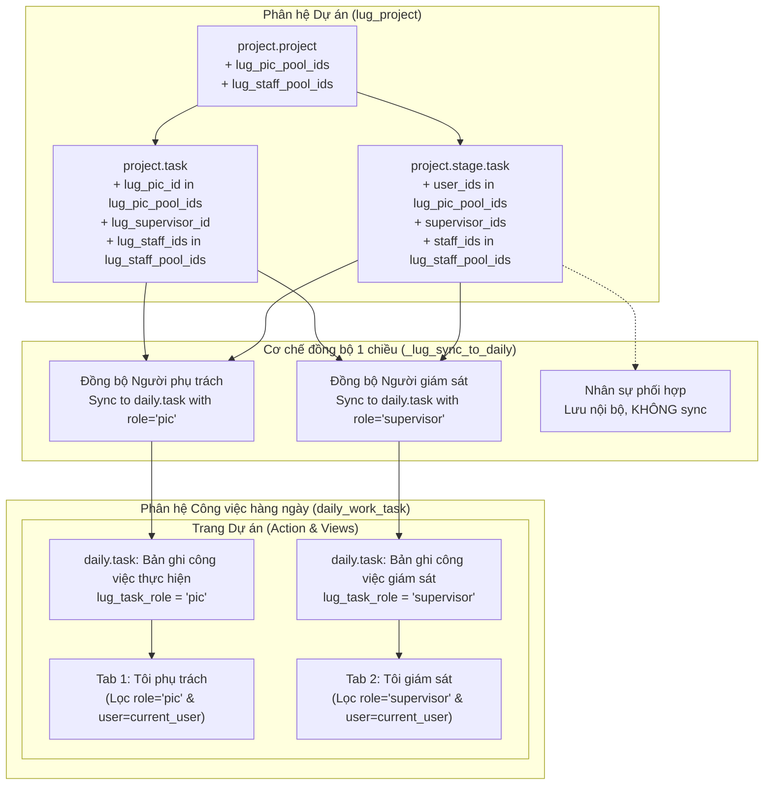

## Goal Capsule

- **Objective:** Cung cấp cơ chế quản lý nhóm nhân sự dự án có cấu trúc và mở rộng đồng bộ công việc sang "Công việc hàng ngày" cho cả người phụ trách và người giám sát, giúp theo dõi đúng vai trò và kiểm soát phạm vi nhân sự trong dự án.
- **Means:** Bổ sung pool chọn nhiều (Many2many) cho "Người phụ trách" và "Nhân sự" trên Dự án (`lug_project`), giới hạn lựa chọn người phụ trách và nhân sự trên từng công việc theo pool tương ứng của dự án, đồng thời mở rộng đồng bộ công việc sang "Công việc hàng ngày" (`daily_work_task`) cho người giám sát và hiển thị qua hai tab phân tách "Tôi phụ trách" và "Tôi giám sát".
- **Product Authority:** Phạm vi áp dụng cho phân hệ quản lý dự án (`lug_project`) và phân hệ công việc hàng ngày (`daily_work_task`). Các phân hệ khác không thuộc phạm vi xử lý của kế hoạch này.
- **Execution Profile:** `code`
- **Open Blockers:** Không có.

---

## Product Contract

### Summary
Thiết lập hai pool nhân sự đa chọn trên Dự án gồm "Người phụ trách" và "Nhân sự", ràng buộc các công việc chi tiết thuộc dự án chỉ được chọn thành viên trong hai pool này. Mở rộng cơ chế đồng bộ công việc 1 chiều từ Dự án sang "Công việc hàng ngày" cho cả "Người giám sát", và tách giao diện trang "Dự án" trong "Công việc hàng ngày" thành hai tab riêng biệt: Tab "Tôi phụ trách" và Tab "Tôi giám sát".

### Problem Frame
Hiện tại trong phân hệ `lug_project`, khi tạo công việc chi tiết cho dự án, người dùng có thể chọn bất kỳ nhân viên nào trong toàn công ty làm người phụ trách, không bị giới hạn theo nhóm nhân sự được chỉ định tham gia dự án. Dự án cũng thiếu trường thông tin lưu danh sách "Nhân sự" tham gia thực hiện dự án và công việc.

Đồng thời, cơ chế đồng bộ sang phân hệ "Công việc hàng ngày" (`daily_work_task`) hiện chỉ tự động tạo và cập nhật công việc cho người trong trường "Người phụ trách". Người được phân công là "Người giám sát" không nhận được công việc trong danh sách của mình, dẫn đến việc người giám sát không nắm được các đầu việc cần theo dõi trừ khi phải truy cập thủ công vào từng dự án. Trang "Dự án" trong "Công việc hàng ngày" cũng chưa có khu vực chuyên biệt để người dùng theo dõi riêng các công việc mình giữ vai trò giám sát.

### Key Decisions
- KTD1. Pool "Người phụ trách" đa chọn trên cấp Dự án (session-settled: user-directed — chosen over single user or sharing the personnel pool: provides a dedicated pool of authorized PICs distinct from general project staff). Thêm trường `lug_pic_pool_ids` (Many2many) trên `project.project` làm danh sách người phụ trách được ủy quyền cho dự án. Governs R1, R3.
- KTD2. Tách hai tab con trên trang "Dự án" trong "Công việc hàng ngày" (session-settled: user-directed — chosen over stacked tables or separate top-level menus: gives clean separation between tasks the user is assigned to execute vs tasks they supervise). Giao diện "Dự án" chia thành Tab "Tôi phụ trách" và Tab "Tôi giám sát" để tách biệt hoàn toàn công việc thực hiện trực tiếp và công việc theo dõi, kiểm soát. Governs R6, R7, R8.
- KTD3. Trường "Nhân sự" đa chọn trên công việc (session-settled: user-directed — chosen over single employee per task: allows assigning a team of staff to collaborate on a single task while restricted to the project personnel pool). Cho phép chọn nhiều người tham gia hỗ trợ hoặc thực hiện công việc từ pool "Nhân sự" của dự án. Governs R4, R5.
- KTD4. Không đồng bộ "Nhân sự" của công việc sang Công việc hàng ngày (session-settled: user-directed — chosen over syncing all staff: keeps personal daily work lists focused on responsible PICs and supervisors without cluttering staff task boards). Trường "Nhân sự" của công việc phục vụ ghi nhận nội bộ dự án, chỉ "Người phụ trách" và "Người giám sát" mới được đồng bộ sang `daily.task`. Governs R5, R6.

### Actors
- A1. Quản lý dự án (Project Manager / Creator): Người tạo dự án, thiết lập pool "Người phụ trách" và pool "Nhân sự" cho dự án, phân công công việc chi tiết.
- A2. Người phụ trách công việc (Task PIC): Người chịu trách nhiệm chính hoàn thành công việc, nhận công việc đồng bộ trong tab "Tôi phụ trách" của "Công việc hàng ngày".
- A3. Người giám sát công việc (Task Supervisor): Người theo dõi, đôn đốc và kiểm tra kết quả công việc, nhận công việc đồng bộ trong tab "Tôi giám sát" của "Công việc hàng ngày".
- A4. Nhân sự phối hợp (Task Personnel): Thành viên tham gia hỗ trợ thực hiện công việc, được lưu tên trên công việc dự án nhưng không nhận task đồng bộ cá nhân.

### Requirements

**Project-Level Pools**
- R1. Thêm trường "Người phụ trách" dạng đa chọn (Many2many `res.users`) trên form Dự án (`project.project`), cho phép người tạo dự án chọn danh sách những người được phép làm người phụ trách trong dự án đó.
- R2. Thêm trường "Nhân sự" dạng đa chọn (Many2many `res.users` hoặc nhân sự nội bộ) trên form Dự án (`project.project`), đại diện cho toàn bộ đội ngũ nhân sự tham gia dự án.

**Task-Level Staffing & Constraints**
- R3. Trên bản ghi công việc (`project.stage.task` và `project.task`), trường "Người phụ trách" chỉ cho phép chọn các cá nhân nằm trong pool "Người phụ trách" của dự án chứa công việc đó.
- R4. Thêm trường "Nhân sự" dạng đa chọn (Many2many) trên bản ghi công việc (`project.stage.task` và `project.task`).
- R5. Trường "Nhân sự" trên bản ghi công việc chỉ cho phép chọn các nhân sự nằm trong pool "Nhân sự" của dự án chứa công việc đó, và các nhân sự này không đồng bộ sang phân hệ "Công việc hàng ngày".

**Daily Work Sync for Supervisors**
- R6. Khi tạo mới hoặc cập nhật công việc trong dự án, hệ thống đồng bộ tự động tạo hoặc cập nhật bản ghi `daily.task` tương ứng trong "Công việc hàng ngày" cho tất cả người dùng trong trường "Người giám sát" (`supervisor_ids` / `lug_supervisor_id`), bên cạnh việc đồng bộ cho "Người phụ trách".
- R7. Bản ghi `daily.task` đồng bộ cho Người giám sát được phân loại vai trò giám sát (e.g. `lug_task_role = 'supervisor'`), tự động cập nhật trạng thái, ngày thực hiện, hạn chót theo công việc gốc trong dự án và tự động xóa khi người dùng bị gỡ khỏi trường Người giám sát.

**Daily Work UI Separation**
- R8. Trong phân hệ "Công việc hàng ngày" (`daily_work_task`), khi người dùng mở trang "Dự án", giao diện hiển thị 2 tab con:
  - Tab "Tôi phụ trách": hiển thị danh sách các công việc dự án mà người dùng hiện tại là Người phụ trách.
  - Tab "Tôi giám sát": hiển thị bảng danh sách các công việc dự án mà người dùng hiện tại là Người giám sát.

### Key Flows

- F1. Thiết lập dự án và phân quyền pool nhân sự
  - **Trigger:** Người quản lý dự án (A1) tạo mới hoặc chỉnh sửa một dự án trong `lug_project`.
  - **Actors:** A1
  - **Steps:**
    1. A1 nhập các thông tin chung của dự án.
    2. A1 chọn danh sách tài khoản cho pool "Người phụ trách" của dự án.
    3. A1 chọn danh sách nhân sự cho pool "Nhân sự" của dự án.
    4. A1 lưu dự án.
  - **Outcome:** Dự án lưu thành công hai pool nhân sự làm căn cứ ràng buộc cho tất cả công việc thuộc dự án.
  - **Governed by:** R1, R2

- F2. Tạo công việc chi tiết có phân công phụ trách, giám sát và nhân sự
  - **Trigger:** A1 tạo công việc chi tiết cho một giai đoạn của dự án.
  - **Actors:** A1, A2, A3, A4
  - **Steps:**
    1. A1 mở form thêm công việc trong giai đoạn dự án.
    2. A1 mở danh sách chọn "Người phụ trách": hệ thống chỉ hiển thị những người thuộc pool "Người phụ trách" của dự án. A1 chọn A2.
    3. A1 mở danh sách chọn "Nhân sự": hệ thống chỉ hiển thị những người thuộc pool "Nhân sự" của dự án. A1 chọn A4.
    4. A1 chọn A3 vào trường "Người giám sát".
    5. A1 nhấn Lưu công việc.
    6. Hệ thống kích hoạt đồng bộ sang `daily_work_task`, tạo `daily.task` cho A2 (vai trò phụ trách) và tạo `daily.task` cho A3 (vai trò giám sát). Không tạo `daily.task` cho A4.
  - **Outcome:** Công việc dự án được lưu với đầy đủ ràng buộc; A2 nhận việc thực hiện; A3 nhận việc giám sát; A4 được ghi nhận trong đội ngũ nhân sự công việc.
  - **Governed by:** R3, R4, R5, R6, R7

- F3. Người giám sát theo dõi công việc dự án trong "Công việc hàng ngày"
  - **Trigger:** Người giám sát (A3) truy cập phân hệ "Công việc hàng ngày" và chọn mục "Dự án".
  - **Actors:** A3
  - **Steps:**
    1. A3 nhấn vào menu hoặc tab "Dự án" trong "Công việc hàng ngày".
    2. Hệ thống hiển thị giao diện gồm hai tab: "Tôi phụ trách" và "Tôi giám sát".
    3. A3 chuyển sang tab "Tôi giám sát".
    4. Hệ thống tải bảng dữ liệu gồm các công việc dự án mà A3 được chỉ định làm Người giám sát, hiển thị rõ tên dự án, tên công việc, trạng thái, hạn chót và người phụ trách chính.
  - **Outcome:** A3 nắm bắt nhanh chóng toàn bộ công việc mình đang giám sát mà không bị lẫn với công việc mình trực tiếp thực hiện.
  - **Governed by:** R8

### Acceptance Examples

- AE1. Giới hạn danh sách chọn Người phụ trách và Nhân sự trên công việc
  - **Covers:** R3, R5
  - **Given:** Dự án "Cải tạo siêu thị" có pool Người phụ trách gồm [User X, User Y] và pool Nhân sự gồm [User M, User N].
  - **When:** Người dùng thêm công việc mới trong dự án này và mở danh sách Người phụ trách hoặc Nhân sự.
  - **Then:** Dropdown Người phụ trách chỉ cho phép chọn User X hoặc User Y (không hiển thị User Z ngoài pool); Dropdown Nhân sự chỉ cho phép chọn User M hoặc User N.

- AE2. Đồng bộ công việc cho Người giám sát sang Công việc hàng ngày
  - **Covers:** R6, R7
  - **Given:** Công việc "Khảo sát mặt bằng" thuộc dự án có Người phụ trách là User X và Người giám sát là User S.
  - **When:** Công việc được lưu với hạn chót là 15/11/2026.
  - **Then:** Hệ thống tự động tạo 1 bản ghi `daily.task` cho User X (vai trò phụ trách) và 1 bản ghi `daily.task` cho User S (vai trò giám sát) với cùng thông tin tiêu đề, ngày hạn chót và dự án gốc.

- AE3. Hiển thị tách biệt trong hai tab của trang Dự án
  - **Covers:** R8
  - **Given:** User S là Người phụ trách của Task A và là Người giám sát của Task B.
  - **When:** User S mở trang "Dự án" trong "Công việc hàng ngày".
  - **Then:** Khi ở tab "Tôi phụ trách", bảng chỉ hiển thị Task A. Khi bấm chuyển sang tab "Tôi giám sát", bảng chỉ hiển thị Task B.

- AE4. Không tạo bản ghi đồng bộ cho nhân sự phối hợp
  - **Covers:** R5
  - **Given:** Công việc có User M được chọn trong trường "Nhân sự" (nhưng không nằm trong Người phụ trách hay Người giám sát).
  - **When:** Công việc được tạo hoặc cập nhật.
  - **Then:** Không có bản ghi `daily.task` nào được tạo hoặc gán cho User M từ công việc này.

- AE5. Dọn dẹp bản ghi đồng bộ khi gỡ Người giám sát
  - **Covers:** R7
  - **Given:** Task B đang có Người giám sát là User S và đã có bản ghi `daily.task` tương ứng cho User S.
  - **When:** Người quản lý gỡ User S ra khỏi trường Người giám sát của Task B.
  - **Then:** Bản ghi `daily.task` tương ứng với vai trò giám sát của User S bị xóa/hủy, không còn xuất hiện trong tab "Tôi giám sát" của User S.

### Scope Boundaries

**Deferred for later**
- Phân quyền chi tiết cho phép Người giám sát đánh giá hoặc duyệt nghiệm thu trực tiếp từ màn hình "Công việc hàng ngày" thay vì mở form công việc dự án gốc.
- Tính năng thông báo tự động (notification/chatter) gửi riêng cho Người giám sát mỗi khi Người phụ trách cập nhật tiến độ công việc.

**Outside this product's identity**
- Đồng bộ công việc 2 chiều từ bản ghi giám sát trong `daily_work_task` ghi ngược lại tiến độ dự án (cơ chế đồng bộ vẫn tuân thủ nghiêm ngặt 1 chiều từ Dự án sang Công việc hàng ngày).
- Tự động gán quyền truy cập bảo mật toàn bộ hệ thống dự án cho người trong pool Nhân sự nếu họ không có quyền nhóm tương ứng.

### Sources / Research
- `lug_project/models/project_project.py`: Khai báo model `project.project`, nơi thêm các pool Many2many cho Người phụ trách và Nhân sự.
- `lug_project/models/project_stage_task.py`: Quản lý công việc chi tiết giai đoạn và hàm `_lug_sync_to_daily()`, nơi mở rộng đồng bộ cho `supervisor_ids`.
- `lug_project/models/project_task.py`: Quản lý công việc dự án kế thừa `project.task` và hàm `_lug_sync_to_todo_and_daily()`.
- `lug_project/models/daily_task.py`: Kế thừa `daily.task` bổ sung trường liên kết dự án gốc và phương thức `action_open_my_project_tasks()`.
- `lug_project/views/daily_task_views.xml`: Định nghĩa view danh sách và action mở công việc dự án trong "Công việc hàng ngày".
- `docs/superpowers/plans/2026-10-12-sync-duan-to-daily-task.md`: Tài liệu kiến trúc đồng bộ 1 chiều từ Dự án sang Công việc hàng ngày.

---

## Planning Contract

### Product Contract Preservation
Product Contract unchanged. Toàn bộ các định danh R1–R8, A1–A4, F1–F3, AE1–AE5 và các KTD từ bản thiết kế requirements được bảo toàn nguyên vẹn.

### Key Technical Decisions
- KTD1. Khai báo quan hệ pool nhân sự trên `project.project` (Governs R1, R2). Thêm `lug_pic_pool_ids` và `lug_staff_pool_ids` là các quan hệ `fields.Many2many("res.users", ...)` độc lập, lưu trữ tại các bảng quan hệ riêng biệt `lug_project_pic_pool_rel` và `lug_project_staff_pool_rel`. Tự động gán fallback nếu dự án cũ đã có `lug_pic_id` thì đưa `lug_pic_id` vào `lug_pic_pool_ids`.
- KTD2. Kiểm tra ràng buộc pool nhân sự 2 tầng (UI domain + Python constraint) (Governs R3, R4, R5). Tầng UI sử dụng dynamic domain theo quan hệ với project (`project_id.lug_pic_pool_ids` và `project_id.lug_staff_pool_ids`). Tầng backend áp dụng `@api.constrains` trên `project.stage.task` và `project.task` nhằm từ chối lưu dữ liệu nếu user được chọn nằm ngoài pool của dự án (áp dụng khi dự án có cấu hình pool).
- KTD3. Mở rộng cơ chế đồng bộ 1 chiều dựa trên cờ vai trò `lug_task_role` (Governs R6, R7). Khai báo trường `lug_task_role = fields.Selection([('pic', 'Người phụ trách'), ('supervisor', 'Người giám sát')], default='pic', index=True)` trên `daily.task`. Hàm `_lug_sync_to_daily()` sẽ duyệt độc lập danh sách Người phụ trách (`user_ids`) và danh sách Người giám sát (`supervisor_ids`), sinh ra các bản ghi `daily.task` riêng biệt có cờ vai trò tương ứng và dọn dẹp các bản ghi bị gỡ bỏ.
- KTD4. Cấu hình giao diện 2 tab trên action và filter của "Công việc hàng ngày" (Governs R8). Nâng cấp `action_open_my_project_tasks()` và file `daily_task_views.xml` để cung cấp 2 chế độ hiển thị rõ ràng: Tab "Tôi phụ trách" lọc theo `[('lug_task_role', '=', 'pic')]` và Tab "Tôi giám sát" lọc theo `[('lug_task_role', '=', 'supervisor')]`, đồng bộ liên kết trên cả backend menu và màn hình web workspace `daily_work_employee_ws`.

### High-Level Technical Design



### Technical Architecture & Model Changes

1. **`project.project` (`lug_project/models/project_project.py`)**:
   - `lug_pic_pool_ids`: `fields.Many2many("res.users", "lug_project_pic_pool_rel", "project_id", "user_id", string="Nhóm người phụ trách", domain="[('share', '=', False)]")`.
   - `lug_staff_pool_ids`: `fields.Many2many("res.users", "lug_project_staff_pool_rel", "project_id", "user_id", string="Nhóm nhân sự", domain="[('share', '=', False)]")`.
   - XML Views: Thêm 2 trường này vào `view_project_intake_form` (khung Thông tin chung) và `edit_project_lug`.

2. **`project.stage.task` (`lug_project/models/project_stage_task.py`)**:
   - `staff_ids`: `fields.Many2many("res.users", "project_stage_task_staff_rel", "task_id", "user_id", string="Nhân sự", domain="[('share', '=', False)]")`.
   - Constraints: `@api.constrains("user_ids", "staff_ids")`: kiểm tra `user_ids` phải thuộc `stage_id.project_id.lug_pic_pool_ids` (nếu pool được thiết lập); kiểm tra `staff_ids` phải thuộc `stage_id.project_id.lug_staff_pool_ids` (nếu pool được thiết lập).
   - Sync method: Mở rộng `_lug_sync_to_daily()` để xử lý song song `user_ids` (vai trò `pic`) và `supervisor_ids` (vai trò `supervisor`).

3. **`project.task` (`lug_project/models/project_task.py`)**:
   - `lug_staff_ids`: `fields.Many2many("res.users", "project_task_staff_rel", "task_id", "user_id", string="Nhân sự", domain="[('share', '=', False)]")`.
   - Constraints: `@api.constrains("lug_pic_id", "lug_staff_ids")`: kiểm tra tương tự với `project_id.lug_pic_pool_ids` và `project_id.lug_staff_pool_ids`.
   - Sync method: Mở rộng `_lug_sync_to_todo_and_daily()` hỗ trợ đồng bộ giám sát.

4. **`daily.task` (`lug_project/models/daily_task.py`)**:
   - `lug_task_role`: `fields.Selection([('pic', 'Người phụ trách'), ('supervisor', 'Người giám sát')], string="Vai trò trong dự án", default="pic", index=True)`.
   - Nâng cấp `action_open_my_project_tasks()` và bổ sung action riêng cho người giám sát: `action_daily_task_my_supervisor_projects()`.

5. **Views & Menus (`lug_project/views/daily_task_views.xml`)**:
   - Thêm filter search: `filter_my_pic` và `filter_my_supervisor`.
   - Cung cấp giao diện 2 tab hoặc phân tách tab/menu trực quan trong trang Dự án.

### Assumptions
- Nếu dự án chưa chọn danh sách pool (để trống), hệ thống không chặn hoàn toàn việc phân công để tránh gây tắc nghẽn vận hành cho các dự án linh hoạt; khi pool đã có dữ liệu, ràng buộc được thực thi nghiêm ngặt.
- Người giám sát chỉ nhận task theo dõi một chiều, việc hoàn thành hoặc thay đổi trạng thái của task dự án vẫn do Người phụ trách hoặc PM điều phối chính.

### Implementation Sequencing
- **U1**: Thêm các trường pool trên `project.project` và cập nhật form dự án.
- **U2**: Thêm trường `staff_ids` trên các model task và thiết lập validation ràng buộc pool.
- **U3**: Bổ sung trường vai trò trên `daily.task` và nâng cấp hàm đồng bộ `_lug_sync_to_daily()`.
- **U4**: Thiết kế giao diện 2 tab "Tôi phụ trách" và "Tôi giám sát" trên "Công việc hàng ngày".
- **U5**: Viết unit test mở rộng kiểm chứng đầy đủ các kịch bản trong Acceptance Examples.

---

## Implementation Units

### U1. Cấu hình Pool Người phụ trách và Nhân sự trên Project
- **Goal:** Bổ sung các trường Many2many lưu trữ nhóm người phụ trách (`lug_pic_pool_ids`) và nhóm nhân sự (`lug_staff_pool_ids`) trên model `project.project`, tích hợp vào form tạo nhanh dự án (`view_project_intake_form`) và form chi tiết dự án (`edit_project_lug`).
- **Requirements:** R1, R2, F1
- **Dependencies:** Không có
- **Files:**
  - `lug_project/models/project_project.py`
  - `lug_project/views/project_project_views.xml`
- **Approach:**
  1. Thêm `lug_pic_pool_ids = fields.Many2many("res.users", "lug_project_pic_pool_rel", "project_id", "user_id", string="Nhóm người phụ trách", domain="[('share', '=', False)]")`.
  2. Thêm `lug_staff_pool_ids = fields.Many2many("res.users", "lug_project_staff_pool_rel", "project_id", "user_id", string="Nhóm nhân sự", domain="[('share', '=', False)]")`.
  3. Cập nhật view `view_project_intake_form` đưa 2 trường này vào khối THÔNG TIN CHUNG dưới dạng widget avatar hoặc multi-tag.
  4. Cập nhật view `edit_project_lug` đưa 2 trường này vào form chi tiết.
- **Patterns to follow:** `lug_assignee_ids` trong `lug_project/models/project_project.py`.
- **Test scenarios:**
  - Tạo mới dự án với đầy đủ danh sách `lug_pic_pool_ids` và `lug_staff_pool_ids`, xác nhận các quan hệ lưu đúng trong database.
  - Dự án tạo mới không chọn pool vẫn lưu bình thường mà không gây lỗi.

### U2. Bổ sung trường Nhân sự và Ràng buộc Pool trên Công việc
- **Goal:** Thêm trường `staff_ids` (đa chọn) trên cả `project.stage.task` và `project.task`, đồng thời áp dụng dynamic domain trên giao diện và constraint Python để đảm bảo Người phụ trách và Nhân sự của task chỉ được chọn từ pool của dự án.
- **Requirements:** R3, R4, R5, AE1, AE4
- **Dependencies:** U1
- **Files:**
  - `lug_project/models/project_stage_task.py`
  - `lug_project/models/project_task.py`
  - `lug_project/views/project_stage_line_views.xml`
  - `lug_project/views/project_project_views.xml`
- **Approach:**
  1. Trên `project.stage.task`: thêm trường `staff_ids = fields.Many2many("res.users", "project_stage_task_staff_rel", "task_id", "user_id", string="Nhân sự", domain="[('share', '=', False)]")`.
  2. Thêm constraint `@api.constrains("user_ids", "staff_ids")`: nếu dự án có `lug_pic_pool_ids` thì mọi user trong `user_ids` phải nằm trong pool đó; nếu dự án có `lug_staff_pool_ids` thì mọi user trong `staff_ids` phải nằm trong pool đó.
  3. Trên `project.task`: thêm trường `lug_staff_ids` và constraint tương tự đối với `lug_pic_id` và `lug_staff_ids`.
  4. Cập nhật các view XML `view_project_stage_task_list`, `view_project_stage_task_popup_form`, `view_project_stage_line_form` hiển thị trường "Nhân sự" (`staff_ids`).
- **Patterns to follow:** `@api.constrains("user_ids")` trong `lug_project/models/project_stage_task.py`.
- **Test scenarios:**
  - Covers AE1. Chọn User hợp lệ nằm trong pool -> Lưu thành công.
  - Covers AE1. Chọn User nằm ngoài pool Người phụ trách của dự án -> Ném ngoại lệ ValidationError.
  - Covers AE1. Chọn User nằm ngoài pool Nhân sự của dự án -> Ném ngoại lệ ValidationError.
  - Covers AE4. Chọn nhiều nhân viên vào trường Nhân sự của task -> Lưu thành công.

### U3. Mở rộng Đồng bộ 1 chiều cho Người giám sát sang Công việc hàng ngày
- **Goal:** Mở rộng cơ chế đồng bộ `_lug_sync_to_daily()` trên `project.stage.task` và `_lug_sync_to_todo_and_daily()` trên `project.task` để tạo, cập nhật và dọn dẹp các bản ghi `daily.task` cho toàn bộ người dùng trong trường "Người giám sát" với cờ `lug_task_role = 'supervisor'`, đảm bảo không đồng bộ trường "Nhân sự".
- **Requirements:** R6, R7, F2, AE2, AE4, AE5
- **Dependencies:** U2
- **Files:**
  - `lug_project/models/daily_task.py`
  - `lug_project/models/project_stage_task.py`
  - `lug_project/models/project_task.py`
- **Approach:**
  1. Trong `lug_project/models/daily_task.py`: thêm trường `lug_task_role = fields.Selection([('pic', 'Người phụ trách'), ('supervisor', 'Người giám sát')], string="Vai trò", default="pic", index=True)`.
  2. Trong `project_stage_task.py` `_lug_sync_to_daily()`:
     - Duyệt `task.user_ids`: tạo/cập nhật `daily.task` với `lug_task_role = 'pic'`.
     - Duyệt `task.supervisor_ids`: tạo/cập nhật `daily.task` với `lug_task_role = 'supervisor'`.
     - Duyệt các `existing_daily_tasks`: kiểm tra nếu bản ghi thuộc vai trò `supervisor` mà user tương ứng không còn trong `supervisor_ids` thì thực hiện `.unlink()`; tương tự cho vai trò `pic`.
     - Bỏ qua hoàn toàn trường `staff_ids`, không sinh task cho nhân viên trong `staff_ids`.
  3. Áp dụng logic tương tự cho `project.task` trong `_lug_sync_to_todo_and_daily()` cho `lug_supervisor_id`.
- **Patterns to follow:** Logic ánh xạ employee `_lug_get_or_create_daily_employee` và context `lug_sync_lock` trong `project_stage_task.py`.
- **Test scenarios:**
  - Covers AE2. Tạo task có Người phụ trách và Người giám sát -> Sinh ra 2 bản ghi `daily.task`, 1 bản ghi `lug_task_role='pic'` và 1 bản ghi `lug_task_role='supervisor'`.
  - Covers AE4. Task có nhân viên trong `staff_ids` -> Không tạo thêm bản ghi `daily.task` cho các nhân viên này.
  - Covers AE5. Gỡ Người giám sát khỏi task -> Bản ghi `daily.task` vai trò giám sát bị xóa, bản ghi của Người phụ trách vẫn giữ nguyên.
  - Cập nhật trạng thái hoặc deadline của task dự án -> Cả 2 bản ghi `daily.task` đều được cập nhật tương ứng.

### U4. Giao diện Phân tách 2 Tab trong Trang Dự án của Công việc hàng ngày
- **Goal:** Xây dựng giao diện phân chia 2 tab: Tab "Tôi phụ trách" và Tab "Tôi giám sát" trong phân hệ "Công việc hàng ngày", cho phép người dùng chuyển đổi mượt mà giữa công việc thực hiện và công việc theo dõi.
- **Requirements:** R8, F3, AE3
- **Dependencies:** U3
- **Files:**
  - `lug_project/models/daily_task.py`
  - `lug_project/views/daily_task_views.xml`
  - `daily_work_task/static/src/employee_ws/daily_work_employee_ws.js`
- **Approach:**
  1. Trong `view_daily_task_project_search`, thêm hai bộ lọc:
     - `<filter string="Tôi phụ trách" name="filter_role_pic" domain="[('lug_task_role', '=', 'pic')]"/>`
     - `<filter string="Tôi giám sát" name="filter_role_supervisor" domain="[('lug_task_role', '=', 'supervisor')]"/>`
  2. Trong `action_open_my_project_tasks()`, bổ sung tham số hoặc cấu hình action để hỗ trợ mở danh sách theo vai trò tương ứng (default `filter_role_pic`).
  3. Tạo action server hoặc action window riêng cho tab giám sát: `action_daily_task_my_supervisor_projects`.
  4. Tạo cấu trúc menu hoặc tab con trực quan:
     - Dưới menu "Dự án" của Công việc hàng ngày, bố trí 2 menu con: "Tôi phụ trách" và "Tôi giám sát".
     - Trong giao diện bảng làm việc nhân viên (`daily_work_employee_ws`), nâng cấp hàm mở trang dự án hoặc cung cấp selector tab con "Tôi phụ trách / Tôi giám sát".
- **Patterns to follow:** `action_open_my_project_tasks()` trong `lug_project/models/daily_task.py`.
- **Test scenarios:**
  - Covers AE3. Người dùng mở trang "Dự án" -> Mặc định tải danh sách công việc Tôi phụ trách (`lug_task_role='pic'`).
  - Covers AE3. Người dùng chuyển sang tab "Tôi giám sát" -> Tải danh sách công việc Tôi giám sát (`lug_task_role='supervisor'`).
  - Công việc user chỉ là người giám sát không bao giờ xuất hiện ở tab "Tôi phụ trách" và ngược lại.

### U5. Bộ Kiểm thử Tự động Toàn diện
- **Goal:** Xây dựng file test `tests/test_project_pools_and_supervisor_sync.py` bao phủ toàn diện tất cả các trường hợp kiểm thử, đảm bảo pass 100% không ảnh hưởng đến các test hiện có.
- **Requirements:** R1–R8, AE1–AE5
- **Dependencies:** U1, U2, U3, U4
- **Files:**
  - `tests/test_project_pools_and_supervisor_sync.py`
- **Approach:**
  1. Tận dụng framework mock Odoo sẵn có trong `tests/test_sync_duan_to_daily.py`.
  2. Viết test case xác thực pool trên `project.project`: lưu trữ và truy vấn `lug_pic_pool_ids`, `lug_staff_pool_ids`.
  3. Viết test case xác thực constraint validation trên `project.stage.task` và `project.task` khi gán người trong và ngoài pool.
  4. Viết test case kiểm tra đồng bộ tạo, cập nhật, xóa `daily.task` cho cả vai trò PIC và Supervisor.
  5. Viết test case kiểm tra việc không đồng bộ cho `staff_ids`.
  6. Viết test case kiểm tra domain lọc tách biệt của 2 tab trên trang Dự án.
- **Patterns to follow:** `tests/test_sync_duan_to_daily.py`.
- **Test scenarios:**
  - Chạy `python3 -m unittest discover tests` và kiểm tra toàn bộ test case mới lẫn 47 test case cũ đều PASS.

---

## Verification Contract

### Automated Verification Gates
Tất cả các lệnh kiểm tra phải chạy thành công từ thư mục gốc `/home/duk/code/KHAN`:

```bash
# 1. Kiểm tra cú pháp Python toàn bộ các file thay đổi
python3 -m py_compile lug_project/models/project_project.py \
                      lug_project/models/project_stage_task.py \
                      lug_project/models/project_task.py \
                      lug_project/models/daily_task.py \
                      tests/test_project_pools_and_supervisor_sync.py

# 2. Kiểm tra cú pháp XML toàn bộ các view thay đổi
python3 -c "import xml.etree.ElementTree as ET; \
            ET.parse('lug_project/views/project_project_views.xml'); \
            ET.parse('lug_project/views/project_stage_line_views.xml'); \
            ET.parse('lug_project/views/daily_task_views.xml'); \
            print('XML syntax validation: PASS')"

# 3. Chạy toàn bộ test suite (bao gồm 47 test cũ và test suite mới)
python3 -m unittest discover tests
```

---

## Definition of Done

### Global Completion Criteria
- [x] Toàn bộ các yêu cầu từ R1 đến R8 được hiện thực đầy đủ và truy xuất được nguồn gốc.
- [x] Không có lỗi cú pháp Python hoặc lỗi cú pháp XML trong các module `lug_project` và `daily_work_task`.
- [x] Toàn bộ bộ kiểm thử tự động trong `tests/` chạy thành công (100% PASS, 59/59 tests pass).
- [x] Cơ chế đồng bộ 1 chiều từ Dự án sang Công việc hàng ngày hoạt động chính xác cho cả Người phụ trách và Người giám sát.
- [x] Trường "Nhân sự" được quản lý nội bộ trên dự án và công việc, không bị đồng bộ nhầm sang công việc hàng ngày cá nhân.
- [x] Trang "Dự án" trong "Công việc hàng ngày" phân tách mạch lạc hai tab "Tôi phụ trách" và "Tôi giám sát".
