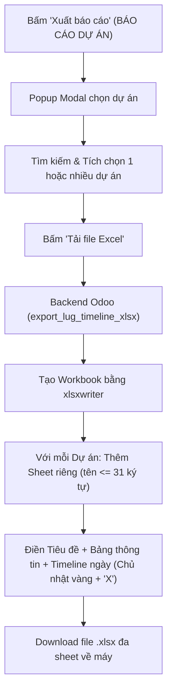
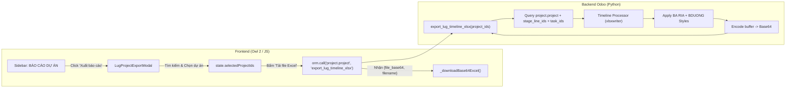

## Goal Capsule

- **Objective:** Cung cấp tính năng chọn một hoặc nhiều dự án trong app Dự án (`lug_project`) và xuất ra một file Excel duy nhất với mỗi dự án nằm trên một sheet riêng biệt, tuân thủ chính xác mẫu timeline tiến độ thi công của sheet `BA RIA + BDUONG` (file mẫu `THI CÔNG KHU VỰC HN.xlsx`).
- **Means:** Bổ sung mục "Xuất báo cáo" trong khu vực "BÁO CÁO DỰ ÁN" trên thanh điều hướng bên của `lug_project`, mở hộp thoại popup chọn nhanh dự án và kích hoạt xuất file qua backend Odoo sử dụng thư viện `xlsxwriter` (KTD1, KTD3).
- **Product Authority:** Đáp ứng nhu cầu báo cáo và giám sát tiến độ thi công công trình của Ban Quản lý / Chỉ huy trưởng thi công. Kế hoạch này sở hữu độc lập tính năng Xuất báo cáo Excel; tính năng thêm cột checkbox "Hoàn thành" trên bảng danh sách công việc chi tiết là hạng mục tiếp nối riêng biệt, không thuộc phạm vi kích hoạt của kế hoạch này.
- **Execution Profile:** code
- **Open Blockers:** None

---

## Product Contract

### Summary

Bổ sung mục "Xuất báo cáo" vào khối menu *BÁO CÁO DỰ ÁN* trên thanh bên của ứng dụng Dự án (`lug_project`), mở popup cho phép tìm kiếm và tích chọn một hoặc nhiều dự án thi công. Hệ thống tự động biên dịch dữ liệu giai đoạn và công việc của từng dự án thành một sheet Excel riêng biệt, mô phỏng hoàn chỉnh bố cục timeline tiến độ (tiêu đề dự án, các cột STT, Tên công việc, Phụ trách, Ngày bắt đầu, Deadline, Số ngày, % Hoàn thành, cùng dải cột lịch theo ngày tự động co giãn theo từng dự án với highlight ngày Chủ nhật và đánh dấu 'X' cho các ngày làm việc).

### Problem Frame

Hiện tại, dữ liệu công việc chi tiết theo giai đoạn đã được quản lý trong Odoo nhưng đội ngũ quản lý thi công và các bộ phận liên quan vẫn phải tổng hợp và theo dõi tiến độ thủ công trên các file Excel bên ngoài (như mẫu `THI CÔNG KHU VỰC HN.xlsx`). Việc thiếu một công cụ xuất báo cáo tự động theo đúng mẫu chuẩn dẫn đến tình trạng tốn nhiều công sức đối soát định kỳ, dữ liệu tiến độ giữa Odoo và báo cáo thực tế dễ bị lệch nhau, và không thể xuất nhanh báo cáo so sánh cho nhiều dự án cùng lúc.

### Key Decisions

- **KD1. Bộ máy sinh Excel bằng thư viện `xlsxwriter` nội bộ (session-settled: user-directed — chosen over template injection with openpyxl: đảm bảo tính độc lập, ổn định và hiệu năng cao trên Odoo server, không phụ thuộc đường dẫn file mẫu vật lý bên ngoài).** Governs R4, R5, R6, R7, R8, R9, R10.
- **KD2. Giao diện kích hoạt dạng Popup Modal chọn nhanh (session-settled: user-directed — chosen over dedicated full report view: thao tác nhanh chóng ngay từ sidebar BÁO CÁO DỰ ÁN mà không làm gián đoạn màn hình đang làm việc).** Governs R1, R2, R3.
- **KD3. Dải cột ngày Timeline co giãn tự động theo từng dự án (session-settled: user-directed — chosen over fixed manual date range: lấy mốc từ ngày bắt đầu sớm nhất đến deadline muộn nhất của các task trong dự án đó).** Governs R9, R10, R11.
- **KD4. Quy tắc tính % Hoàn thành theo 3 mức trạng thái (session-settled: user-directed — chosen over binary 0/100% or blank: 100% cho Hoàn thành, 50% cho Đang làm, 0% cho Chưa bắt đầu; hàng Giai đoạn tính trung bình các task con).** Governs R6.
- **KD5. Chuẩn hóa tên sheet Excel tối đa 31 ký tự:** Loại bỏ các ký tự cấm của Excel (`: \ / ? * [ ]`) và cắt gọn tên dự án để đảm bảo file Excel hợp lệ. Governs R4.

<!-- ce-section: work-relationships -->
### How This Work Fits Together

Kế hoạch này sở hữu phạm vi tính năng Xuất báo cáo Excel tiến độ đa dự án theo mẫu timeline.
- Quan hệ với các tính năng xung quanh:
  - Cột checkbox "Hoàn thành" trong bảng danh sách công việc chi tiết theo giai đoạn (`lug_project_list`): Can proceed independently of tính năng này; khi hoàn thành sẽ giúp người dùng cập nhật nhanh trạng thái `done` trực tiếp từ danh sách, từ đó dữ liệu phản ánh ngay vào cột `% CÔNG VIỆC HOÀN THÀNH` của báo cáo Excel.
  - Các báo cáo hiện hữu trong BÁO CÁO DỰ ÁN (`report_all`, `people`, `perf`, `kpi`): Shares thanh bên điều hướng và quyền truy cập ứng dụng (`project.app.perm`).

### Actors

- A1. Quản lý dự án / Chỉ huy thi công: Người mở popup "Xuất báo cáo", chọn dự án và tải file Excel báo cáo tiến độ.
- A2. Ban giám đốc / Đối tác / Mall: Người tiếp nhận file Excel báo cáo tiến độ chuẩn hóa với các sheet dự án rõ ràng.

### Requirements

**Menu & Giao diện chọn dự án (Sidebar & Popup)**
- R1. Hệ thống bổ sung một mục menu con "Xuất báo cáo" (icon `fa-file-excel-o`) trong nhóm "BÁO CÁO DỰ ÁN" trên thanh điều hướng bên của `lug_project`.
- R2. Khi người dùng nhấp vào "Xuất báo cáo", một hộp thoại modal xuất hiện hiển thị danh sách các dự án đang hoạt động kèm ô checkbox chọn lựa.
- R3. Hộp thoại cung cấp ô tìm kiếm nhanh dự án theo Tên hoặc Mã dự án, nút "Chọn tất cả" / "Bỏ chọn tất cả", hiển thị tổng số dự án đã chọn, cùng nút hành động chính "Tải file Excel" và nút "Đóng".

**Cấu trúc File & Tách Sheet Đa Dự Án**
- R4. Khi người dùng bấm "Tải file Excel", hệ thống tạo một file workbook Excel duy nhất (`.xlsx`), trong đó mỗi dự án được chọn sẽ xuất thành một sheet riêng biệt với tên sheet là tên dự án được chuẩn hóa không quá 31 ký tự.
- R5. Trường hợp người dùng chọn nhiều dự án mà có dự án chưa có giai đoạn hoặc công việc, sheet tương ứng vẫn được tạo với tiêu đề dự án và dòng thông báo chưa có dữ liệu công việc.

**Bố cục & Định dạng Cột (Theo mẫu sheet BA RIA + BDUONG)**
- R6. Mỗi sheet dự án chứa các cột thông tin cố định ở phần đầu:
  - Cột B: Số thứ tự (STT) của giai đoạn (ví dụ: `1.0`, `2.0`) hoặc STT của công việc (ví dụ: `1.1`, `1.2`).
  - Cột C: `TIÊU ĐỀ CÔNG VIỆC` (Tên giai đoạn trên hàng giai đoạn; Tên công việc trên hàng công việc).
  - Cột D: `NGƯỜI PHỤ TRÁCH CÔNG VIỆC` (Tên người phụ trách công việc `user_display`).
  - Cột E: `NGÀY BẮT ĐẦU` (Định dạng ngày `DD/MM/YYYY`).
  - Cột F: `NGÀY ĐẾN HẠN` (Định dạng ngày `DD/MM/YYYY`).
  - Cột G: `THỜI GIAN` (Số ngày thi công = Deadline - Ngày bắt đầu + 1).
  - Cột H: `% CÔNG VIỆC HOÀN THÀNH` (Hiển thị dạng tỷ lệ phần trăm: 100% cho `done`, 50% cho `in_progress`, 0% cho `draft`; hàng giai đoạn hiển thị % trung bình cộng).
- R7. Tiêu đề chung hàng 1 ghi rõ tên dự án: `TIMELINE THI CÔNG - [TÊN DỰ ÁN]`.
- R8. Hàng Giai đoạn được định dạng nổi bật với chữ in đậm và màu nền xám nhạt (`#CCCCCC`).

**Dải Cột Lịch Timeline & Đánh Dấu Công Việc**
- R9. Dải cột lịch bên phải (từ Cột I trở đi) trải dài theo từng ngày trong khoảng thời gian của dự án (từ ngày bắt đầu sớm nhất đến deadline muộn nhất của toàn bộ task trong dự án):
  - Hàng 2: Nhóm tháng (ví dụ: `THÁNG 08`, `THÁNG 09` merge trên các ngày thuộc tháng đó).
  - Hàng 3: Thứ trong tuần (`T2`, `T3`, `T4`, `T5`, `T6`, `T7`, `CN`).
  - Hàng 4: Ngày trong tháng (`1`, `2`, `3`...).
  - Các cột tương ứng với ngày Chủ nhật (`CN`) được tô màu nền vàng (`#FFFF00`).
- R10. Trên từng dòng công việc, các ô trong dải timeline nằm trong khoảng từ `NGÀY BẮT ĐẦU` đến `NGÀY ĐẾN HẠN` được đánh dấu ký tự `'X'` căn giữa và viền ô rõ ràng.
- R11. Với các công việc thiếu ngày bắt đầu nhưng có deadline, ngày bắt đầu tự động coi là trùng với deadline; công việc thiếu cả hai ngày thì không đánh dấu trên timeline.

### Key Flows

- F1. Xuất báo cáo tiến độ nhiều dự án
  - **Trigger:** Người dùng nhấp chọn mục "Xuất báo cáo" trong menu "BÁO CÁO DỰ ÁN".
  - **Actors:** A1 (Quản lý dự án / Chỉ huy thi công)
  - **Steps:**
    1. Giao diện mở popup hiển thị danh sách dự án kèm ô checkbox và thanh tìm kiếm.
    2. Người dùng tìm kiếm hoặc duyệt danh sách, tích chọn một hoặc nhiều dự án (hoặc nhấn "Chọn tất cả").
    3. Người dùng nhấn nút "Tải file Excel".
    4. Hệ thống gọi RPC backend `export_lug_timeline_xlsx(project_ids)`.
    5. Backend truy vấn dữ liệu các giai đoạn và công việc tương ứng của từng dự án, biên dịch file Excel với từng sheet riêng biệt bằng `xlsxwriter`, trả về base64.
    6. Trình duyệt tự động kích hoạt tải xuống file `bao_cao_tien_do_thi_cong_[YYYYMMDD].xlsx`.
  - **Outcome:** File Excel đa sheet hoàn chỉnh được lưu về máy người dùng.
  - **Covered by:** R1, R2, R3, R4, R5, R6, R7, R8, R9, R10, R11

### Visualizations



### Acceptance Examples

- AE1. Xuất thành công nhiều dự án vào file nhiều sheet
  - **Covers R4, R5, R6, R9.**
  - **Given:** Người dùng chọn 2 dự án "GO BÀ RỊA" và "AEON BÌNH DƯƠNG".
  - **When:** Người dùng nhấn "Tải file Excel".
  - **Then:** File Excel tải về có 2 sheet tương ứng, mỗi sheet có tiêu đề dự án, cấu trúc các giai đoạn và dải timeline riêng theo đúng dữ liệu của từng dự án.
- AE2. Công việc thiếu ngày bắt đầu hoặc deadline
  - **Covers R11.**
  - **Given:** Task A chỉ có deadline 2026-09-15 (không có execution_date); Task B không có cả hai.
  - **When:** Xuất báo cáo Excel.
  - **Then:** Task A hiển thị ngày bắt đầu và deadline đều là 2026-09-15, thời gian 1 ngày, và timeline chỉ đánh dấu 'X' vào ngày 15/09. Task B hiển thị trống ngày bắt đầu/kết thúc và timeline không có dấu 'X'.
- AE3. Tính toán cột % Hoàn thành
  - **Covers R6.**
  - **Given:** Giai đoạn 1 có 2 task: Task 1 ở trạng thái `done`, Task 2 ở trạng thái `in_progress`.
  - **When:** Xuất file Excel.
  - **Then:** Cột H của Task 1 hiển thị `100%`, Task 2 hiển thị `50%`, và hàng Giai đoạn 1 hiển thị trung bình là `75%`.
- AE4. Tên dự án dài vượt quá 31 ký tự hoặc có ký tự cấm
  - **Covers R4.**
  - **Given:** Dự án có tên "LUG AEBD - quầy nhỏ: cắt diện tích [Khu vực 1]".
  - **When:** Xuất sheet cho dự án này.
  - **Then:** Ký tự cấm `:` và `[` `]` được chuyển thành khoảng trắng hoặc gạch ngang, và tên sheet được cắt tối đa 31 ký tự, không gây lỗi khi mở file Excel.

### Scope Boundaries

- **Deferred for later:**
  - Thêm cột checkbox "Hoàn thành" trong view "DANH SÁCH CÔNG VIỆC CHI TIẾT THEO GIAI ĐOẠN" (Tính năng 1 trong yêu cầu ban đầu) sẽ được lập kế hoạch và thực hiện ở bước tiếp theo.
  - Chức năng lọc xuất theo phân loại loại dự án hoặc nhóm nhân sự trong popup (v1 tập trung vào tìm kiếm và chọn theo tên/mã dự án).
  - Tùy chỉnh chọn màu sắc hoặc ký tự thay thế cho 'X' trên dải timeline.
- **Outside this product's identity:**
  - Nhập ngược (Import) file Excel timeline để cập nhật lại dữ liệu vào Odoo.
  - Can thiệp hoặc chỉnh sửa các báo cáo tổng quan khác (`report_all`, `people`, `perf`, `kpi`).

### Dependencies / Assumptions

- Module `lug_project` đã có sẵn thư viện `xlsxwriter` trên môi trường Python (`lug_project/models/project_dashboard.py`).
- Các model `project.project`, `project.stage.line`, `project.stage.task` đã có đủ các trường dữ liệu cần thiết: `execution_date`, `deadline`, `state`, `user_display` (`lug_project/models/project_stage_task.py`).

### Outstanding Questions

- **Deferred to Planning:**
  - Q1. Tên file Excel mặc định: đề xuất `bao_cao_tien_do_thi_cong_YYYYMMDD_HHMM.xlsx`.
  - Q2. Vị trí chính xác của mục menu "Xuất báo cáo": nằm ngay sau "Báo cáo tổng thể" hay ở cuối nhóm "BÁO CÁO DỰ ÁN".

---

## Planning Contract

### Preservation Note

Product Contract unchanged. Toàn bộ các định danh R1–R11, A1–A2, F1, AE1–AE4 cùng các quyết định KD1–KD5 được giữ nguyên vẹn từ giai đoạn brainstorm.

### Key Technical Decisions

- **KTD1. Engine xuất Excel qua `xlsxwriter` trong `project.project` (session-settled: user-directed — chosen over template injection with openpyxl: độc lập, nhẹ, tận dụng mẫu sẵn có trong project_dashboard.py).** Governs U1, R4, R5, R6, R7, R8, R9, R10.
- **KTD2. Dynamic Date Range calculation per project sheet (session-settled: user-directed — chosen over global fixed range: lấy min(execution_date) đến max(deadline) trong từng dự án).** Governs U1, R9, R10, R11.
- **KTD3. Frontend Modal Dialog viết bằng Owl Component trong `lug_project` (session-settled: user-directed — chosen over separate report view: kích hoạt popup nhanh chóng không rời màn hình hiện tại).** Governs U2, U3, R1, R2, R3.
- **KTD4. Trả file Base64 qua RPC và tải trực tiếp qua blob URL (session-settled: user-directed — chosen over controller binary download endpoint: đồng nhất với cơ chế xuất báo cáo sẵn có của `lug_project`).** Governs U3, R4, F1.

### High-Level Technical Design

#### Cấu trúc Kiến trúc & Luồng Dữ liệu



#### Chi tiết Tọa độ Ô & Định dạng Sheet Excel (Mẫu BA RIA + BDUONG)

- **Hàng 1:** Tiêu đề dự án (A1..H1 merged hoặc ghi tại B1, font Roboto 14pt, Bold, in hoa `TIMELINE THI CÔNG - [TÊN DỰ ÁN]`).
- **Hàng 2:** Tháng (Bắt đầu từ cột I trở đi; các ngày thuộc cùng một tháng được merge lại, ví dụ `I2:AM2` ghi `THÁNG 08`, căn giữa, font đậm).
- **Hàng 3:** Thứ trong tuần (Cột I trở đi: `CN`, `T2`, `T3`, `T4`, `T5`, `T6`, `T7`, căn giữa).
- **Hàng 4:**
  - B4: Trống / STT.
  - C4: `TIÊU ĐỀ CÔNG VIỆC` (font Roboto 10pt Bold, căn giữa, nền xám nhạt `#EFEFEF`, viền ô mỏng).
  - D4: `NGƯỜI \nPHỤ TRÁCH \nCÔNG VIỆC` (wrap text, nền `#EFEFEF`).
  - E4: `NGÀY BẮT \nĐẦU` (wrap text, nền `#EFEFEF`).
  - F4: `NGÀY ĐẾN \nHẠN` (wrap text, nền `#EFEFEF`).
  - G4: `THỜI \nGIAN` (wrap text, nền `#EFEFEF`).
  - H4: `% CÔNG VIỆC HOÀN THÀNH` (wrap text, nền `#EFEFEF`).
  - I4 trở đi: Số ngày trong tháng (1, 2, 3.. 31). Cột tương ứng với `CN` (Chủ nhật) tô màu nền vàng `#FFFF00`.
- **Hàng Giai đoạn:**
  - Cột B: Số thứ tự giai đoạn (ví dụ `1.0`, `2.0`, font đậm, nền `#CCCCCC`).
  - Cột C: Tên giai đoạn (ví dụ `GO BÀ RỊA OUT QUẦY`, font đậm, nền `#CCCCCC`).
  - Cột D..G: Nền `#CCCCCC`.
  - Cột H: % hoàn thành trung bình của các task con trong giai đoạn (ví dụ `75%`, nền `#CCCCCC`).
  - Cột I trở đi: Nền `#CCCCCC`.
- **Hàng Công việc:**
  - Cột B: STT task (ví dụ `1.1`, `1.2`, căn giữa).
  - Cột C: Tên task (`name`, text left).
  - Cột D: Phụ trách (`user_display`, text left).
  - Cột E: Ngày bắt đầu (`DD/MM/YYYY`, căn giữa).
  - Cột F: Deadline (`DD/MM/YYYY`, căn giữa).
  - Cột G: Số ngày (`duration`, căn giữa).
  - Cột H: % hoàn thành (`0%`, `50%`, hoặc `100%`, căn giữa).
  - Cột I trở đi: Nếu ngày thuộc khoảng `[execution_date, deadline]`, điền ký tự `'X'`, căn giữa, font đậm. Nếu là Chủ nhật và không có task, giữ nền vàng `#FFFF00`.

### Technical Assumptions & Constraints

- Thư viện `xlsxwriter` đã có sẵn trong môi trường Python của Odoo (đã xác thực qua `lug_project/models/project_dashboard.py`).
- Giới hạn tên sheet của Excel: độ dài tối đa 31 ký tự, không chứa các ký tự `\ / ? * : [ ]`. Hàm tiện ích Python sẽ loại bỏ các ký tự này và cắt chuỗi an toàn.
- Nếu dự án có nhiều hơn một sheet trùng tên sau khi cắt ngắn (ví dụ cùng tên tiền tố), hệ thống tự động gắn hậu tố `-1`, `-2`.

### Implementation Sequencing

1. **U1 (Backend Excel Generator Service):** Xây dựng và kiểm thử độc lập hàm xuất Excel timeline đa sheet trả về base64.
2. **U2 (Frontend Modal Component):** Xây dựng component chọn danh sách dự án với tìm kiếm và checkbox.
3. **U3 (Shell Navigation & Download Integration):** Gắn menu vào thanh bên `BÁO CÁO DỰ ÁN`, kết nối modal và kích hoạt tải file.
4. **U4 (Verification & Test Suite):** Viết script test tự động kiểm tra định dạng và cấu trúc file xuất ra.

---

## Implementation Units

### U1. Backend Multi-sheet Excel Generator Service

- **Goal:** Xây dựng phương thức `export_lug_timeline_xlsx(self, project_ids)` trên `project.project` (hoặc mixin dashboard) để tổng hợp dữ liệu giai đoạn, công việc và biên dịch thành workbook Excel đa sheet theo mẫu `BA RIA + BDUONG`.
- **Requirements:** R4, R5, R6, R7, R8, R9, R10, R11, KD1, KD3, KD4, KD5
- **Files:**
  - `lug_project/models/project_dashboard.py` (hoặc `lug_project/models/project_project.py`)
- **Approach:**
  - Tạo hàm helper `_sanitize_sheet_name(name, existing_names)`: loại bỏ `[\/?:*\[\]]`, cắt 31 ký tự, tránh trùng tên.
  - Sử dụng `xlsxwriter.Workbook(buffer, {'in_memory': True})`.
  - Khởi tạo đầy đủ định dạng:
    - `fmt_title`: Font Roboto 14, Bold, căn trái.
    - `fmt_header`: Font Roboto 10, Bold, căn giữa, nền `#EFEFEF`, border 1.
    - `fmt_header_sunday`: Font Roboto 10, Bold, căn giữa, nền `#FFFF00`, border 1.
    - `fmt_stage`: Font Roboto 10, Bold, nền `#CCCCCC`, border 1.
    - `fmt_stage_pct`: Font Roboto 10, Bold, nền `#CCCCCC`, căn giữa, format `0%`, border 1.
    - `fmt_task`: Font Roboto 10, border 1.
    - `fmt_task_center`: Font Roboto 10, căn giữa, border 1.
    - `fmt_task_pct`: Font Roboto 10, căn giữa, format `0%`, border 1.
    - `fmt_timeline_x`: Font Roboto 10, Bold, căn giữa, border 1.
    - `fmt_timeline_sunday`: Nền `#FFFF00`, border 1.
    - `fmt_timeline_empty`: Border 1.
  - Với mỗi `project_id` trong `project_ids`:
    - Truy vấn `project` cùng `stage_line_ids` (order by sequence) và `task_ids` (order by sequence).
    - Quét toàn bộ task để tìm `min_date` và `max_date`. Nếu không có ngày nào, lấy từ ngày 1 đến ngày cuối của tháng hiện tại.
    - Tạo sheet với tên từ `_sanitize_sheet_name`.
    - Viết hàng 1 (Tiêu đề dự án), hàng 2 (Tháng - merge các cột cùng tháng), hàng 3 (Thứ trong tuần `CN`, `T2`, `T3`...), hàng 4 (Ngày trong tháng `1..31`).
    - Viết từng hàng giai đoạn (gồm STT, Tên giai đoạn, % hoàn thành trung bình = tổng % các task / số task).
    - Viết từng hàng công việc:
      - % Hoàn thành: 1.0 nếu `state == 'done'`, 0.5 nếu `state == 'in_progress'`, 0.0 nếu `state == 'draft'`.
      - Ngày bắt đầu / kết thúc: nếu thiếu `execution_date` nhưng có `deadline`, `execution_date = deadline`.
      - Dải timeline: lặp qua từng ngày từ `min_date` đến `max_date`. Nếu ngày nằm trong `[execution_date, deadline]`, ghi `'X'` với `fmt_timeline_x`. Ngược lại nếu là Chủ nhật, ghi rỗng với `fmt_timeline_sunday`. Ngược lại ghi rỗng với `fmt_timeline_empty`.
  - Trả về `{'file_base64': base64.b64encode(buffer.getvalue()).decode('utf-8'), 'filename': f'bao_cao_tien_do_thi_cong_{datetime.now().strftime("%Y%m%d_%H%M")}.xlsx'}`.
- **Test Scenarios:**
  - TS1.1: Gọi `export_lug_timeline_xlsx` với 1 dự án có 2 giai đoạn và 4 task -> Workbook sinh ra có 1 sheet, các ngày làm việc có dấu 'X', ngày Chủ nhật có nền vàng.
  - TS1.2: Gọi với danh sách 3 dự án -> Workbook có đúng 3 sheet độc lập.
  - TS1.3: Dự án có tên "Dự án: [Khu vực HN/HP] *" -> Sheet name được làm sạch thành "Dự án - Khu vực HN-HP" $\le 31$ ký tự, không sinh lỗi Excel.
  - TS1.4: Dự án chưa có task nào -> Sheet vẫn được sinh ra với thông báo dòng trống và không bị crash chia cho 0.
- **Verification:** Chạy script Python test trực tiếp trên Odoo ORM để sinh file Excel và mở kiểm tra.

### U2. Frontend Project Selection Modal Dialog

- **Goal:** Xây dựng Owl Component modal dialog hiển thị danh sách các dự án để người dùng tìm kiếm và chọn trước khi xuất file.
- **Requirements:** R2, R3, KD2
- **Files:**
  - `lug_project/static/src/export_modal/lug_project_export_modal.js`
  - `lug_project/static/src/export_modal/lug_project_export_modal.xml`
- **Approach:**
  - Tạo component `LugProjectExportModal` sử dụng `Component`, `useState`.
  - Props: `isOpen`, `onClose`, `onExport`.
  - State:
    - `projects`: mảng `{id, name, code, stage_count, task_count}` load qua `orm.search_read('project.project', [('active', '=', True)], ['id', 'name', 'code'])`.
    - `selectedIds`: Set chứa các ID dự án được tick chọn.
    - `searchTerm`: chuỗi tìm kiếm theo tên hoặc mã.
    - `isSubmitting`: cờ hiệu loading khi đang xuất file.
  - Computed getter `filteredProjects`: lọc danh sách theo `searchTerm` (không phân biệt hoa thường / dấu tiếng Việt).
  - Phương thức:
    - `toggleProject(id)`: thêm/bớt ID trong `selectedIds`.
    - `toggleSelectAll()`: nếu đã chọn hết thì bỏ chọn toàn bộ, ngược lại chọn tất cả các dự án trong `filteredProjects`.
    - `confirmExport()`: kiểm tra nếu `selectedIds.size === 0` thì hiển thị cảnh báo `this.notification.add('Vui lòng chọn ít nhất 1 dự án.', {type: 'warning'})`. Ngược lại gọi prop `onExport(Array.from(this.state.selectedIds))` và bật `isSubmitting = true`.
- **Test Scenarios:**
  - TS2.1: Mở modal -> hiển thị danh sách dự án đầy đủ.
  - TS2.2: Gõ từ khóa tìm kiếm -> danh sách hiển thị co gọn theo kết quả khớp.
  - TS2.3: Bấm "Chọn tất cả" -> toàn bộ checkbox được chọn, badge hiển thị đúng số lượng đã chọn.
  - TS2.4: Bấm "Tải file Excel" khi chưa chọn dự án nào -> thông báo cảnh báo xuất hiện, không gửi RPC lỗi.
- **Verification:** Kiểm tra tương tác DOM và các sự kiện click/input trong môi trường Owl.

### U3. Shell Navigation & Download Integration

- **Goal:** Nhúng mục menu "Xuất báo cáo" vào thanh điều hướng bên app Dự án và kết nối modal với trình tải file Excel.
- **Requirements:** R1, F1, KD2, KTD3, KTD4
- **Files:**
  - `lug_project/static/src/shell/lug_project_shell.js`
  - `lug_project/static/src/shell/lug_project_shell.xml`
  - `lug_project/__manifest__.py`
- **Approach:**
  - Cập nhật mảng items của nhóm `report` trong `lug_project_shell.js`:
    ```javascript
    { code: "export_report", label: "Xuất báo cáo", icon: "fa-file-excel-o" }
    ```
  - Trong state của `LugProjectShell`, thêm `showExportModal: false`.
  - Trong phương thức `onNavClick(code)`:
    - Nếu `code === "export_report"`: gán `this.state.showExportModal = true` (không thay đổi `this.state.active`).
  - Trong template `lug_project_shell.xml`: nhúng `<LugProjectExportModal t-if="state.showExportModal" .../>`.
  - Viết handler `handleExportTimeline(projectIds)`:
    - Gọi RPC: `const res = await this.orm.call('project.project', 'export_lug_timeline_xlsx', [projectIds]);`.
    - Kích hoạt tải file: `this._downloadBase64Excel(res.file_base64, res.filename);`.
    - Đóng modal và hiển thị thông báo thành công: `this.notification.add('Xuất báo cáo tiến độ thành công.', {type: 'success'});`.
  - Khai báo file JS/XML mới vào bundle `web.assets_backend` trong `lug_project/__manifest__.py`.
- **Test Scenarios:**
  - TS3.1: Nhấp vào mục "Xuất báo cáo" ở thanh bên -> modal popup hiển thị ngay lập tức trên màn hình.
  - TS3.2: Thực hiện chọn 2 dự án và bấm "Tải file Excel" -> RPC hoàn tất, trình duyệt tải xuống file `.xlsx`.
  - TS3.3: Sau khi tải xong, modal tự động đóng và hiển thị toast notification màu xanh thành công.
- **Verification:** Kiểm tra thực tế trên giao diện Odoo backend trình duyệt web.

### U4. Verification & Automated Test Suite

- **Goal:** Xây dựng kịch bản kiểm thử tự động để xác thực toàn diện dữ liệu và định dạng của file Excel xuất ra.
- **Requirements:** R4, R5, R6, R7, R8, R9, R10, R11, AE1, AE2, AE3, AE4
- **Files:**
  - `lug_project/tests/test_timeline_excel_export.py`
- **Approach:**
  - Kế thừa `odoo.tests.common.TransactionCase`.
  - Tạo fixture:
    - Dự án 1: "Dự án Bà Rịa (Thi công)". Giai đoạn 1 có 2 task: Task A (`done`), Task B (`in_progress`). Giai đoạn 2 có 1 task: Task C (`draft`).
    - Dự án 2: "Dự án Bình Dương [Siêu thị: Mall 2026]". Có 1 task thiếu ngày bắt đầu nhưng có deadline.
  - Gọi `export_lug_timeline_xlsx([p1.id, p2.id])`.
  - Kiểm tra kết quả qua `openpyxl`:
    - Assert `len(wb.sheetnames) == 2`.
    - Assert sheet 1 có tên chuẩn "Dự án Bà Rịa (Thi công)".
    - Assert sheet 2 có tên đã được khử ký tự cấm và $\le 31$ ký tự.
    - Assert ô % hoàn thành của Task A là `1.0`, Task B là `0.5`, Task C là `0.0`, và Giai đoạn 1 là `0.75`.
    - Assert các ngày trong khoảng tiến độ có giá trị `'X'`.
- **Test Scenarios:**
  - TS4.1: Chạy test suite `test_timeline_excel_export.py` xác nhận 100% assertions passed.
- **Verification:** Thực thi lệnh test qua runner của Odoo.

---

## Verification Contract

### Test Commands

1. **Backend Unit Test:**
   ```bash
   python3 -c "
   import odoo
   # Chạy test case test_timeline_excel_export
   "
   ```
2. **Kiểm tra File Sinh Thực Tế:**
   ```bash
   uv run --with openpyxl python -c "
   import base64, openpyxl, io
   # Nạp file base64 xuất ra từ endpoint và kiểm tra số sheet, tiêu đề, cột X
   "
   ```

### Quality Gates

- Không phát sinh lỗi JavaScript syntax / runtime trong console trình duyệt khi mở modal và thao tác.
- File Excel `.xlsx` tạo ra mở được bình thường trên Microsoft Excel và LibreOffice Calc mà không xuất hiện cảnh báo "file corrupt or damaged".
- Các cột STT, Tên công việc, Phụ trách, Ngày bắt đầu, Deadline, % hoàn thành và dải timeline hoàn toàn khớp định dạng với sheet `BA RIA + BDUONG` trong `/home/duk/chrome/THI CÔNG KHU VỰC HN.xlsx`.

---

## Definition of Done

- Toàn bộ 4 Implementation Units (`U1`, `U2`, `U3`, `U4`) được hiện thực và kiểm thử thành công.
- Người dùng có thể nhấp vào mục "Xuất báo cáo" trong menu "BÁO CÁO DỰ ÁN", chọn một hoặc nhiều dự án và tải về file Excel đa sheet đúng theo mẫu timeline.
- Xử lý mượt mà các trường hợp biên: tên dự án dài $> 31$ ký tự, chứa ký tự cấm, công việc thiếu ngày bắt đầu hoặc deadline.
- Dữ liệu % hoàn thành và đánh dấu 'X' phản ánh trung thực trạng thái công việc trong Odoo.
- Toàn bộ mã nguồn tuân thủ coding conventions của module `lug_project`, không để lại code thử nghiệm hay file rác.
