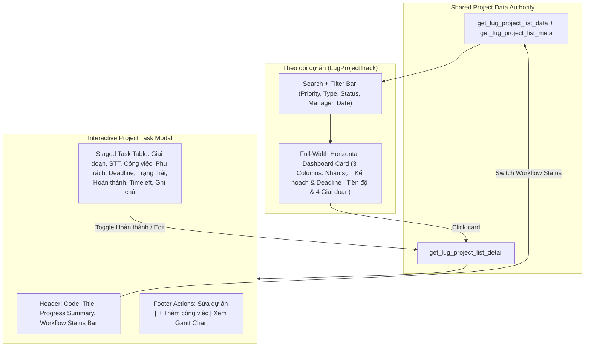
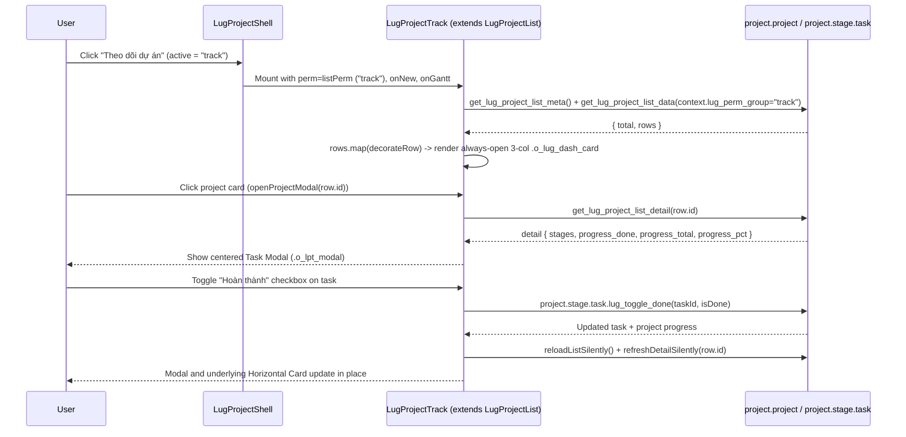

# "Theo dõi dự án" Sync and Interactive Task Modal - Plan

## Goal Capsule

- **Objective:** Project managers and staff viewing "Theo dõi dự án" see live project progress, deadline warning colors, and 4-phase status identical to "Danh sách dự án" on full-width horizontal cards, and can click any project card to view and update all of its tasks in a modal.
- **Means:** Extend `LugProjectList` in `LugProjectTrack` to share live row decoration, filter controls, and modal-bound task actions while registering `"track"` in the list permission group set (`KTD1`, `KTD2`, `KTD3`).
- **Product authority:** User-confirmed scope from interactive brainstorm dialogue; Product Contract unchanged.
- **Stop conditions:** Any regression in "Danh sách dự án" card expansion or failure of `"track"` permission checks blocks completion.
- **Execution profile:** Standard code implementation verified by Python unit and structural tests under `tests/`.

---

## Product Contract

### Summary

Unify "Theo dõi dự án" with the live data source and card decoration of "Danh sách dự án" so every project renders as an always-expanded, full-width 3-column Horizontal Dashboard Card with accurate colors, progress percentage, and 4-phase pills. Clicking any project card opens an interactive modal displaying all staged tasks of that project with direct task completion toggling, task detail navigation, workflow status switching, and quick project actions.

### Problem Frame

Previously, "Theo dõi dự án" rendered Odoo's legacy kanban view (`view_project_kanban_horizontal_dashboard`), which read stale stored fields and grouped by `last_update_status` rather than the live workflow and task-stage calculations used by "Danh sách dự án". Meanwhile, an unfinished replacement component (`LugProjectTrack`) switched the layout to narrow 4-column kanban cards without applying the row decoration logic, stripping out the 3-column horizontal dashboard layout, circular progress donut, deadline badge colors, and 4-phase pills. Users also lacked a way to click a project in "Theo dõi dự án" to inspect and act on all of its stage tasks inside a modal without leaving the tracking board.

### Key Decisions

- **Full-width Horizontal Dashboard Cards always visible** (session-settled: user-directed — chosen over 4-column status Kanban board: preserves the rich 3-column project tracking overview with personnel, deadline status, circular progress donut, and 4 management phases visible at a glance). Governs R2, R3.
- **Full interactive task modal on project card click** (session-settled: user-directed — chosen over read-only task modal: allows users to tick task completion, open task details, change project status, and trigger project actions directly from "Theo dõi dự án"). Governs R5, R6, R7, R8.
- **Live two-way state refresh between modal and tracking cards** — Toggling a task's completion or changing workflow status inside the modal updates both the modal and the underlying horizontal card in place without a full page reload. Governs R9.
- **Shared search and filter bar with "Danh sách dự án"** — "Theo dõi dự án" exposes the same search and filter controls so users can slice tracked projects by priority, type, workflow status, manager, and date window. Governs R4.

### Requirements

**Data Synchronization & Card Rendering**

- R1. "Theo dõi dự án" fetches project rows and filter metadata from the same backend endpoints as "Danh sách dự án" (`get_lug_project_list_data` and `get_lug_project_list_meta`) so project codes, titles, types, personnel, deadlines, workflow statuses, progress percentages, and phase steps match across both views.
- R2. Each project in "Theo dõi dự án" renders as a full-width Horizontal Dashboard Card with its 3-column body (`NHÂN SỰ`, `KẾ HOẠCH & DEADLINE`, and `TIẾN ĐỘ THỰC HIỆN DỰ ÁN`) visible by default without requiring an expand toggle.
- R3. Each Horizontal Dashboard Card applies the same visual color and progress rules as "Danh sách dự án", including project type tone pills, late-deadline red border and badges, workflow status badge tones, conic-gradient circular percentage donut, progress bar fill tone, contract file download chips, and the 4 management phase pills (`GĐ 1: Chuẩn bị`, `GĐ 2: Thực hiện`, `GĐ 3: Nghiệm thu`, `GĐ 4: Đóng DA`) with `done`, `active`, and `todo` states.
- R4. "Theo dõi dự án" provides search input, urgent-only toggle, pagination, and filter selectors for priority, project type, workflow status, project manager, and date range matching "Danh sách dự án".

**Interactive Project Task Modal**

- R5. Clicking a project card in "Theo dõi dự án" opens a centered modal dialog displaying the project's details and all tasks grouped by stage from `get_lug_project_list_detail`, while clicking interactive links inside the card such as contract file downloads or delete buttons does not trigger the modal.
- R6. The modal header displays the project code, title, completed/total task count, overall progress percentage, workflow status switcher (`Đang làm`, `Tạm dừng`, `Hoàn thành`, `Hủy`), and a close control triggered by either the close icon or backdrop click.
- R7. The modal body renders the staged task table with columns `GIAI ĐOẠN`, `STT`, `TÊN CÔNG VIỆC GIAI ĐOẠN`, `PHỤ TRÁCH`, `DEADLINE`, `TRẠNG THÁI`, `HOÀN THÀNH`, `TIMELEFT`, and `GHI CHÚ`, showing an explicit empty-stage row when a stage has no tasks and an empty-state message when the project has no stages.
- R8. Inside the modal, users with write permission (`canWrite`) can toggle the `HOÀN THÀNH` checkbox on any task, switch the project's workflow status, click a task row to open its form dialog, and use footer buttons for `Sửa dự án`, `+ Thêm công việc`, and `Xem Gantt Chart`; read-only users can view the modal and open `Xem Gantt Chart` with write controls disabled or hidden.
- R9. When a user toggles a task's `HOÀN THÀNH` checkbox, switches project workflow status, or closes a task/project edit dialog launched from the modal, both the open modal and the corresponding card in "Theo dõi dự án" refresh their progress percentage, task counts, phase pill states, and status badges in place.

### Key Flows

- F1. Browse and filter projects in "Theo dõi dự án"
  - **Trigger:** User selects "Theo dõi dự án" in the `lug_project` sidebar or changes a search/filter control.
  - **Steps:** The view loads metadata and paginated project rows, decorates each row with progress tones, deadline states, and 4-phase pills, and renders full-width 3-column horizontal cards.
  - **Outcome:** User sees live project cards matching "Danh sách dự án" without needing to expand individual rows.
  - **Covered by:** R1, R2, R3, R4

- F2. Inspect and update project tasks via the Modal
  - **Trigger:** User clicks a Horizontal Dashboard Card in "Theo dõi dự án".
  - **Steps:** The view opens the modal in a loading state, fetches `get_lug_project_list_detail` for that project, renders the staged task table and action controls, and processes user interactions including toggling `HOÀN THÀNH`, switching workflow state, opening a task form, adding a task, editing the project, or navigating to Gantt.
  - **Outcome:** Task and project updates persist and immediately reflect in both the modal and the horizontal card list.
  - **Covered by:** R5, R6, R7, R8, R9

### Acceptance Examples

- AE1. Synced horizontal card appearance
  - **Covers R1, R2, R3.**
  - **Given:** A project in "Danh sách dự án" has 50% progress, an overdue deadline where `deadline_late` is true, active phase 2 `GĐ 2: Thực hiện`, and 1 contract attachment.
  - **When:** The user opens "Theo dõi dự án".
  - **Then:** The project card immediately shows the 3-column horizontal body with a red late border and deadline badge, a 50% red conic-gradient donut and progress bar, `GĐ 1` marked done with `✓`, `GĐ 2` marked active with `▶`, and a clickable contract download chip.

- AE2. Toggling task completion inside the modal
  - **Covers R5, R7, R8, R9.**
  - **Given:** A user with write permission clicks a project card that has 1 of 2 tasks completed to open the task modal.
  - **When:** The user checks the `HOÀN THÀNH` box on the second task in the modal.
  - **Then:** The task state updates to `Hoàn thành`, the modal header updates to `2 / 2 hoàn thành` at 100%, and the project card behind the modal updates its donut, progress bar, and phase pills to 100%.

- AE3. Read-only user permission enforcement in the modal
  - **Covers R8.**
  - **Given:** A user without write permission on the "Theo dõi dự án" permission group opens a project's task modal.
  - **When:** The modal renders.
  - **Then:** The `HOÀN THÀNH` checkboxes are disabled, workflow status switcher and `Sửa dự án` / `+ Thêm công việc` buttons are hidden, and `Xem Gantt Chart` remains available.

### Scope Boundaries

- Inline text editing of task names, assignees, deadlines, or notes directly inside the modal table cells is out of scope; editing those fields uses the existing Odoo form popup when clicking a task row or `Sửa dự án`.
- Drag-and-drop card reordering or kanban column drag-and-drop in "Theo dõi dự án" is out of scope.

### Sources / Research

- `lug_project/static/src/list/lug_project_list.js` and `lug_project/static/src/list/lug_project_list.xml` — canonical row decoration via `decorateRow`, filter bar, 3-column horizontal card markup `.o_lug_dash_card` and `.o_lug_dash_body`, and staged task table interactions (`toggleTaskDone`, `openTask`, `addTask`, `editProject`, `viewGantt`).
- `lug_project/static/src/list/lug_project_list.scss` — styling for `.o_lug_dash_card`, `.o_lug_dash_body`, `.o_lug_dash_donut`, `.o_lug_dash_pills`, and `.o_lug_plist_phases_table`.
- `lug_project/static/src/track/lug_project_track.js`, `lug_project/static/src/track/lug_project_track.xml`, and `lug_project/static/src/track/lug_project_track.scss` — current component mounted by `LugProjectShell` when `state.active === "track"`.
- `lug_project/static/src/shell/lug_project_shell.xml` — mounts `LugProjectTrack` inside `.o_lps_view_host--ptrack` and passes permissions and callbacks (`listPerm`, `viewGanttForProject`).
- `lug_project/models/project_dashboard.py` — defines `get_lug_project_list_data`, `get_lug_project_list_meta`, `get_lug_project_list_detail`, `lug_set_workflow_state`, and `lug_toggle_stage_task_done`.

---

## Planning Contract

### Key Technical Decisions

- KTD1. **Subclass `LugProjectList` in `LugProjectTrack` with a dedicated template** (session-settled: user-directed — chosen over 4-column status Kanban board: reuses `loadMeta`, `loadList`, `decorateRow`, and filter state directly from `LugProjectList` while rendering every project card with its 3-column `.o_lug_dash_body` always visible). Governs R1, R2, R3, R4.
- KTD2. **Drive the task modal from `state.expandedId` and `state.details[expandedId]`** (session-settled: user-directed — chosen over read-only task modal: allows `toggleTaskDone`, `setWorkflow`, `openTask`, `addTask`, `editProject`, and `refreshDetailSilently` inherited from `LugProjectList` to update both the modal and the card list in place without duplicate state handlers). Governs R5, R6, R7, R8, R9.
- KTD3. **Add `"track"` to `LIST_GROUPS`, include `isProjectTrack` in `LugProjectShell.listPerm`, and pass `permKwargs` on list read/export calls** — Adding `"track"` to `LIST_GROUPS` in `lug_project/models/project_app_perm.py`, extending `LugProjectShell.listPerm` to resolve `"track"`, and merging `this.permKwargs` into `loadList`, `reloadListSilently`, and `exportExcel` ensures read, export, and modal write actions all enforce the "Theo dõi dự án" row of the permission matrix. Governs R4, R8.
- KTD4. **Align legacy Odoo Kanban fields (`progress`, `phase_num`) with `lug_progress_pct` and `_lug_phase_tracker`** — Updating `_compute_project_progress` and `_compute_project_phase` in `lug_project/models/project_project.py` keeps native Odoo Kanban fallbacks consistent with the shell views. Governs R1, R3.

### High-Level Technical Design

### Sequencing

1. `U1` updates backend permission group resolution (`LIST_GROUPS`) and legacy Kanban computed fields first so the backend contract for `"track"` is ready.
2. `U2` updates `LugProjectShell`, `LugProjectTrack` (JS, XML, SCSS), and adds unit/structural tests verifying both the backend and frontend contracts.

---

## Implementation Units

### U1. Backend Permission Group and Legacy Kanban Field Sync

- **Goal:** Register `"track"` in `LIST_GROUPS` so `lug_perm_group="track"` is honored on list data and write actions, and align `project.project` legacy Kanban computed fields with live progress and phase calculations.
- **Requirements:** R1, R3, R8 (KTD3, KTD4)
- **Dependencies:** None
- **Files:**
  - `lug_project/models/project_app_perm.py`
  - `lug_project/models/project_project.py`
  - `tests/test_track_view_sync.py`
- **Approach:**
  1. In `lug_project/models/project_app_perm.py`, include `"track"` in `LIST_GROUPS` so `_lug_list_perm_group` returns `"track"` when the context carries `lug_perm_group = "track"`.
  2. In `lug_project/models/project_project.py`, update `_compute_project_progress` to use the same task/legacy progress calculation as `_compute_lug_progress_pct`, and update `_compute_project_phase` to account for `lug_workflow_state` alongside `stage_line_ids.task_ids.state`.
- **Patterns to follow:** `lug_project/models/project_app_perm.py` for `_lug_list_perm_group` and `_lug_check_list_write`, and `lug_project/models/project_dashboard.py` for `_lug_phase_tracker`.
- **Test scenarios:**
  - **Happy path:** Calling `_lug_list_perm_group` with `lug_perm_group: "track"` in context returns `"track"`, while `archived=True` returns `"archived"` and `overdue=True` returns `"overdue"`.
  - **Edge case:** Calling `_lug_list_perm_group` with an unknown context group falls back to `"list"`.
  - **Integration scenario:** `_lug_serialize_project_row` and `get_lug_project_list_detail` return matching `progress_pct`, `status`, `deadline_state`, and 4-step `phase` data for a project with stage tasks.
- **Verification:** `tests/test_track_view_sync.py` passes for all backend permission and serialization/compute assertions.

### U2. Shell Wiring and `LugProjectTrack` Horizontal Cards + Interactive Task Modal

- **Goal:** Render full-width 3-column Horizontal Dashboard Cards in "Theo dõi dự án" using `LugProjectList` data/decoration and open a centered interactive task modal when clicking any project card.
- **Requirements:** R1, R2, R3, R4, R5, R6, R7, R8, R9, F1, F2, AE1, AE2, AE3 (KTD1, KTD2, KTD3)
- **Dependencies:** U1
- **Files:**
  - `lug_project/static/src/shell/lug_project_shell.js`
  - `lug_project/static/src/shell/lug_project_shell.xml`
  - `lug_project/static/src/list/lug_project_list.js`
  - `lug_project/static/src/track/lug_project_track.js`
  - `lug_project/static/src/track/lug_project_track.xml`
  - `lug_project/static/src/track/lug_project_track.scss`
  - `tests/test_track_view_sync.py`
- **Approach:**
  1. In `lug_project/static/src/shell/lug_project_shell.js`, update `listPerm` so `code` resolves to `this.state.active` when `this.isProjectList || this.isProjectTrack`, and in `lug_project/static/src/shell/lug_project_shell.xml`, pass `perm="listPerm"`, `onNew`, and `onGantt` bindings to `LugProjectTrack`.
  2. In `lug_project/static/src/list/lug_project_list.js`, merge `...this.permKwargs` into the kwargs passed to `this.orm.call` in `loadList`, `reloadListSilently`, and `exportExcel`, and update `setWorkflow` to invoke `reloadListSilently` and `refreshDetailSilently` so `status_tone`, `status_badge`, and phase pills update in place.
  3. In `lug_project/static/src/track/lug_project_track.js`, make `LugProjectTrack` extend `LugProjectList` with `static template = "lug_project.LugProjectTrack"`, default `permKwargs` group to `"track"`, and add modal helpers `openProjectModal`, `closeProjectModal`, `activeModalRow`, and `viewGanttFromModal`.
  4. In `lug_project/static/src/track/lug_project_track.xml`, render the toolbar and filter bar matching `LugProjectList`, render each row in `.o_lug_plist_board` as `.o_lug_dash_card.is-open` with `.o_lug_dash_head` and the 3-column `.o_lug_dash_body` always visible, and wire card click to `openProjectModal` with click-stop on contract links and delete button.
  5. In `lug_project/static/src/track/lug_project_track.xml` and `lug_project_track.scss`, enable vertical scrolling on `.o_lps_view_host.o_lps_view_host--ptrack` matching `.o_lps_view_host--plist`, and render the centered modal `.o_lpt_modal_backdrop` and `.o_lpt_modal` when `state.expandedId` is set, containing the project header, workflow status buttons, staged task table with `HOÀN THÀNH` checkbox, clickable task rows, and footer actions (`Sửa dự án`, `+ Thêm công việc`, `Xem Gantt Chart`).
- **Patterns to follow:** `lug_project/static/src/list/lug_project_list.js`, `lug_project/static/src/list/lug_project_list.xml`, and `lug_project/static/src/list/lug_project_list.scss`.
- **Test scenarios:**
  - **Happy path:** `Covers F1 / AE1.` `LugProjectTrack` inherits `decorateRow` and renders `.o_lug_dash_card` with `.o_lug_dash_body` always visible without an `isExpanded` condition, including `.o_lug_dash_donut`, `.o_lug_dash_bar`, and `.o_lug_dash_pills`.
  - **Happy path:** `Covers F2 / AE2.` Clicking a project card invokes `openProjectModal` to open `.o_lpt_modal_backdrop` and renders the staged task table with the `HOÀN THÀNH` checkbox wired to `toggleTaskDone` and task row click wired to `openTask`.
  - **Edge case:** `Covers AE3.` When `canWrite` is false, the modal hides workflow switcher buttons, `Sửa dự án`, and `+ Thêm công việc`, and disables the `HOÀN THÀNH` checkboxes while keeping `Xem Gantt Chart` visible.
  - **Edge case:** Clicking contract file download links or the delete button on a card uses `t-on-click.stop` so the task modal does not open unintentionally.
- **Verification:** `tests/test_track_view_sync.py` verifies the OWL template structure, JS component inheritance and methods, shell prop bindings, and XML validity.

---

## Verification Contract

| Check | Command | Applies to | Pass criterion |
|---|---|---|---|
| Track view sync & modal unit tests | `python3 -m unittest tests/test_track_view_sync.py` | U1, U2 | All tests pass with exit code 0 |
| Stage task done toggle regression tests | `python3 -m unittest tests/test_stage_task_done_toggle.py` | U1, U2 | All tests pass with exit code 0 |
| Phase tracker regression tests | `python3 -m unittest tests/test_phase_tracker.py` | U1 | All tests pass with exit code 0 |
| XML & Python syntax validation | `python3 -m py_compile lug_project/models/project_app_perm.py lug_project/models/project_project.py` | U1, U2 | Zero syntax errors |

---

## Definition of Done

- All requirements `R1`–`R9`, flows `F1`–`F2`, and acceptance examples `AE1`–`AE3` are satisfied by `U1` and `U2`.
- `LugProjectTrack` renders full-width 3-column Horizontal Dashboard Cards synced with `get_lug_project_list_data` and opens the interactive task modal on card click.
- `LugProjectShell` passes `"track"` permissions and callbacks (`onNew`, `onGantt`) to `LugProjectTrack`.
- All verification commands in the Verification Contract pass with exit code 0.
- No abandoned experimental or dead-end code remains in the diff.
