## Goal Capsule

- **Objective:** Enable project managers to capture external partner associations directly during task creation and viewing in `lug_project`, and ensure all assigned task team members receive automated advance warnings via Odoo Discuss and web notifications before stage task deadlines arrive.
- **Means:** Add an unconstrained text field "Đối tác" to project stage task forms and lists in `lug_project` (isolated from `daily.task`), introduce a configurable "Thời gian thông báo" (advance lead time in days) in `lug_project` configuration, and dispatch automated Odoo Discuss messages and web notifications to all assignees, supervisors, and staff when tasks enter the warning threshold. (KTD1, KTD2, KTD3, KTD4)
- **Product authority:** Governs task partner data entry and automated deadline alerts within `lug_project`. Full mobile UI responsiveness for `lug_project` and `daily_work_task` is excluded and tracked as a separate upcoming effort.
- **Open blockers:** None.

---

<!-- ce-section: work-relationships -->
## How This Work Fits Together

This plan delivers the core data entry and alerting enhancements for project tasks in `lug_project`.

- **Current focus (this plan):**
  - Project task partner field ("Đối tác") in `lug_project`.
  - Configurable deadline advance notification threshold ("Thời gian thông báo") and automated notification engine.
- **Broader context & surrounding areas:**
  - `Can proceed independently of` **Mobile UI Responsive Overhaul**: Adapting OWL templates and stylesheets in `lug_project` and `daily_work_task` for mobile screens is an independent frontend track that will be addressed in a subsequent workstream.
  - `Explicitly decoupled from` **Daily Task Sync for Partner Data**: The "Đối tác" field remains purely internal to `lug_project` and is not propagated to `daily.task` during stage task synchronization.

---

## Product Contract

### Summary

Add an editable "Đối tác" text field to task creation and detail views in `lug_project` without syncing it to daily tasks. Pair this with a configurable lead time setting ("Thời gian thông báo" in days) that triggers an automated check, alerting all assigned users, supervisors, and staff via Odoo Discuss and web notifications once per deadline as tasks approach expiration.

### Problem Frame

Project managers frequently coordinate tasks with external partners and clients, but the task creation popup (`view_project_stage_task_popup_form`) and task lists currently offer no field to record this context. Consequently, partner names are either mixed into task notes or lost.

At the same time, stage tasks across projects risk slipping past their deadlines because team members receive no proactive warning as the due date approaches. Without automated advance reminders, assignees only notice deadlines after tasks become overdue, leading to project delivery delays and rushed completions.

### Key Decisions

- **Isolated "Đối tác" text field on stage tasks:** (session-settled: user-directed — chosen over syncing to daily.task: user explicitly requested adding the field to task creation and detail views without syncing to "Công việc hàng ngày"). Governs R1, R2, R3, R4.
- **Advance warning window configured in days:** (session-settled: user-directed — chosen over fixed daily clock time or dual schedule: user chose an advance lead time threshold of N days before task deadline). Governs R5, R6.
- **Notification delivery via Odoo Discuss and Web Bus:** (session-settled: user-directed — chosen over email or activities: user chose Odoo Discuss inbox/chat messages and web notifications). Governs R10, R11.
- **Broad recipient group on task:** (session-settled: user-directed — chosen over assignees only: all assigned roles including assignees, supervisors, and staff receive the notification). Governs R9.
- **Idempotent one-shot alerting per deadline:** (session-settled: user-directed — chosen over repeated daily nag: alerts fire once per deadline for active tasks, resetting only if the deadline date changes). Governs R8, R12.

### Actors

- **A1. Project Manager:** Configures the project settings (lead notification time) and creates stage tasks, specifying external partner names when applicable.
- **A2. Task Assignee (`user_ids`):** Assigned user responsible for executing the task, receiving the advance deadline notification in their Odoo Discuss inbox.
- **A3. Task Supervisor (`supervisor_ids`):** Oversees task execution, receiving the deadline notification alongside assignees.
- **A4. Task Staff Member (`staff_ids`):** Additional team member assigned to the task, receiving the deadline notification.
- **A5. Automated Alert Cron:** System background job that periodically evaluates upcoming deadlines against the configured lead time.

### Requirements

#### Task Partner Field ("Đối tác")

- R1. The `project.stage.task` model must include a text field `partner_name` (labeled "Đối tác") allowing arbitrary text input.
- R2. The task creation popup (`view_project_stage_task_popup_form`) must display the "Đối tác" field for user entry during task creation.
- R3. The stage task list (`view_project_stage_task_list`) and standard task stage form (`view_lug_stage_task_form`) must display the "Đối tác" field.
- R4. Synchronization from `project.stage.task` to `daily.task` via `_lug_sync_to_daily` must NOT write or transfer the "Đối tác" value to `daily.task`.

#### Deadline Notification Configuration ("Thời gian thông báo")

- R5. `lug_project` must provide a configuration setting "Thời gian thông báo" storing the advance notification lead time as a positive number of days (defaulting to 1 day).
- R6. The configuration parameter must be accessible to project administrators under project configuration settings and persisted via `ir.config_parameter`.

#### Automated Deadline Notification Engine

- R7. An automated scheduled action (`ir.cron`) must periodically check all active stage tasks (`state` not in `done`, `cancel`) that have a deadline set.
- R8. When the duration between the current date and the task deadline is less than or equal to the configured "Thời gian thông báo" (in days), the system must identify the task as approaching deadline.
- R9. For each identified task that has not yet been notified for its current deadline, the system must dispatch a notification to all users in `user_ids`, `supervisor_ids`, and `staff_ids`.
- R10. The notification message content must follow the format: `"Công việc [Tên công việc] sắp đến thời hạn, vui lòng nhanh chóng hoàn thành và xác nhận công việc"`.
- R11. Notifications must be delivered through Odoo Discuss inbox/chat messages and live web bus notifications.
- R12. Each task must record its notification state to ensure the warning is sent exactly once per deadline, and reset this state if the task's `deadline` date is modified.

### Key Flows

- F1. Creating a task with a partner name
  - **Trigger:** Project manager clicks "+ Thêm công việc" in a project stage.
  - **Actors:** A1 (Project Manager)
  - **Steps:**
    1. Manager opens the stage task popup dialog.
    2. Manager enters task name, selects assigned users, sets dates, and enters partner name into "Đối tác".
    3. Manager clicks "Lưu & Đóng".
    4. Task is saved with the partner name and displayed in the stage task list.
    5. Daily task sync runs without copying the partner field to `daily.task`.
  - **Covered by:** R1, R2, R3, R4

- F2. Automated deadline reminder alert
  - **Trigger:** Scheduled cron job executes its periodic scan.
  - **Actors:** A5 (Automated Alert Cron), A2 (Assignee), A3 (Supervisor), A4 (Staff)
  - **Steps:**
    1. Cron reads the configured lead time (e.g., 2 days) from `lug_project` configuration.
    2. Cron queries active stage tasks with `deadline` within the next 2 days that have not been notified for this deadline.
    3. For each matching task, cron composes the message: `"Công việc [Tên công việc] sắp đến thời hạn, vui lòng nhanh chóng hoàn thành và xác nhận công việc"`.
    4. Cron dispatches Discuss messages and web bus notifications to all users in `user_ids`, `supervisor_ids`, and `staff_ids`.
    5. Task is flagged as notified for the current deadline.
  - **Covered by:** R5, R6, R7, R8, R9, R10, R11, R12

- F3. Deadline modification resets alert state
  - **Trigger:** User updates the `deadline` of an already-notified stage task to a later date.
  - **Actors:** A1 (Project Manager) or A2 (Assignee)
  - **Steps:**
    1. User changes the deadline date on the stage task and saves.
    2. The system resets the task's notification state.
    3. When the new deadline enters the configured warning window, the cron sends a fresh notification.
  - **Covered by:** R12

### Acceptance Examples

- AE1. Field "Đối tác" persistence and isolation
  - **Covers R1, R2, R4.**
  - **Given:** A project manager opens the "Thêm công việc" popup in a duan.
  - **When:** The manager inputs "Công ty TNHH ABC" into the "Đối tác" field and saves the task.
  - **Then:** The task detail view shows "Công ty TNHH ABC" in the "Đối tác" field, and any synced `daily.task` record has no partner field created or modified.

- AE2. Advance notification dispatch within threshold
  - **Covers R7, R8, R9, R10, R11.**
  - **Given:** "Thời gian thông báo" is set to 2 days, today is 2026-11-07, and Task "Khảo sát mặt bằng" has `deadline` = 2026-11-09 with state "in_progress".
  - **When:** The scheduled reminder cron runs.
  - **Then:** All users in `user_ids`, `supervisor_ids`, and `staff_ids` receive a Discuss notification stating: `"Công việc Khảo sát mặt bằng sắp đến thời hạn, vui lòng nhanh chóng hoàn thành và xác nhận công việc"`.

- AE3. No duplicate notifications for unchanged deadline
  - **Covers R12.**
  - **Given:** Task "Khảo sát mặt bằng" was notified during the morning cron run.
  - **When:** The cron runs again in the afternoon on the same day with no change to the task's deadline.
  - **Then:** No duplicate notification is sent to any user.

- AE4. Completed or cancelled tasks are skipped
  - **Covers R7.**
  - **Given:** A task has `deadline` within 1 day, but its `state` is "done" or "cancel".
  - **When:** The scheduled reminder cron runs.
  - **Then:** No notification is generated for this task.

### Scope Boundaries

#### Deferred for later
- **Mobile UI Responsive Overhaul:** Responsive adjustments for cards, tables, dashboards, and kanban views across `lug_project` and `daily_work_task` modules are deferred to a dedicated frontend styling pass.
- **Custom notification templates:** Ability for project managers to customize reminder message templates per project.
- **Multi-interval alerts:** Sending tiered reminders (e.g., both 3 days before and 1 day before).

#### Outside this scope
- **Daily task partner field sync:** Propagating or mapping "Đối tác" to `daily.task` or `res.partner` records.
- **External email or SMS delivery:** Sending alerts through external mail servers or SMS gateways.

### Dependencies / Assumptions

- **Odoo version:** Odoo 19 environment (verified by existing module migrations and ORM conventions).
- **Discuss Bot User:** Notifications can leverage the existing `business_discuss_bots` bot user or standard Odoo notification bot to post messages without triggering spam validation errors.
- **Date timezone:** Cron deadline comparison evaluates dates using Odoo's contextual user or company timezone (`context_today`).

### Outstanding Questions

- **Resolve Before Planning:** None.
- **Deferred to Planning:** None (all resolved in Planning Contract below).

### Sources / Research

- `lug_project/models/project_stage_task.py`: Defines `project.stage.task` fields (`name`, `deadline`, `user_ids`, `supervisor_ids`, `staff_ids`, `state`) and `_lug_sync_to_daily()` sync logic.
- `lug_project/views/project_stage_line_views.xml`: Defines `view_project_stage_task_popup_form` ("Thêm công việc") and `view_project_stage_task_list`.
- `lug_project/data/ir_cron_data.xml`: Existing cron and config parameter structure (`ir.config_parameter`, `ir.cron`).
- `daily_work_task/models/daily_task.py`: Reference implementation for Discuss bot notifications (`_post_assign_bot_discuss_message`) and overdue detection.

---

## Planning Contract

### Key Technical Decisions

- KTD1. **Persist "Thời gian thông báo" via `ir.config_parameter` `lug_project.notify_lead_days`:** Implement `res.config.settings` extension in `lug_project` with field `lug_notify_lead_days = fields.Integer(string="Thời gian thông báo (ngày)", config_parameter="lug_project.notify_lead_days", default=1)`. Governs R5, R6.
- KTD2. **Deduplicate alerts via `lug_notified_deadline` on `project.stage.task`:** Add `lug_notified_deadline = fields.Date(string="Deadline đã thông báo", copy=False, index=True)`. Clear this field in `write()` whenever `vals.get('deadline')` changes, ensuring idempotent one-shot notification per target date. Governs R8, R12.
- KTD3. **Discuss & Bus delivery without external email:** Collect unique partners from `user_ids`, `supervisor_ids`, and `staff_ids` (filtering active internal users with `partner_id`). Post Discuss notification via internal direct channel and broadcast via `_bus_send` (or `mail.thread` notification without email subtype) to prevent external email generation while guaranteeing instant web inbox popup. Governs R9, R10, R11.
- KTD4. **Strict isolation of `partner_name`:** Define `partner_name = fields.Char(string="Đối tác")` on `project.stage.task` and `lug_partner_name = fields.Char(string="Đối tác")` on `project.task`. Leave `_lug_sync_to_daily()` untouched regarding partner payload so `daily.task` records never receive or require this field. Governs R1, R2, R3, R4.

### High-Level Technical Design

```mermaid
flowchart TD
    subgraph S1["Task Creation & Storage"]
        UI1["view_project_stage_task_popup_form"] -->|"Input partner_name"| PST["project.stage.task (partner_name)"]
        PST -->|"_lug_sync_to_daily (partner omitted)"| DT["daily.task (isolated)"]
    end

    subgraph S2["Configuration"]
        CFG["res.config.settings (Project Config)"] -->|"Save lug_notify_lead_days"| ICP["ir.config_parameter: lug_project.notify_lead_days (default 1)"]
    end

    subgraph S3["Automated Alert Engine (ir.cron)"]
        CRON["ir.cron: ir_cron_lug_stage_task_deadline_reminder"] -->|"Every hour / day"| QUERY["Query active tasks with deadline <= today + N days"]
        QUERY --> FILTER{"lug_notified_deadline != deadline?"}
        FILTER -->|No| SKIP["Skip (Already notified)"]
        FILTER -->|Yes| MSG["Compose Message:\n'Công việc [name] sắp đến thời hạn...'"]
        MSG --> DISPATCH["Send to user_ids, supervisor_ids, staff_ids\nvia Odoo Discuss & Web Bus"]
        DISPATCH --> MARK["Write lug_notified_deadline = task.deadline"]
    end
```



### Implementation Constraints & Sequencing

1. **Sequencing:** U1 (Task Partner Field) and U2 (Configuration Settings) can proceed in parallel as they touch orthogonal models and views. U3 (Automated Deadline Reminder Engine) depends on U1 (`project.stage.task` model changes) and U2 (`ir.config_parameter` definition).
2. **Odoo 19 Compatibility:** In Odoo 19, `ir.cron` delegates execution to server actions or direct model methods. Ensure cron XML records specify `model_id` pointing to `model_project_stage_task` and execute `model._cron_check_deadline_reminders()`.
3. **Migration Safe:** Use `fields.Char` and `fields.Date` with safe defaults; no database backfills or heavy schema locks required.

---

## Implementation Units

### U1. Project Stage Task Partner Field ("Đối tác")
- **Goal:** Add and expose the "Đối tác" text field in `project.stage.task` and `project.task` views while guaranteeing isolation from `daily.task`.
- **Requirements:** R1, R2, R3, R4
- **Dependencies:** None
- **Files:**
  - `lug_project/models/project_stage_task.py`
  - `lug_project/models/project_task.py`
  - `lug_project/views/project_stage_line_views.xml`
  - `lug_project/views/project_stage_views.xml`
  - `tests/test_project_stage_task_partner.py`
- **Approach:**
  1. Add `partner_name = fields.Char(string="Đối tác")` on `ProjectStageTask` in `lug_project/models/project_stage_task.py`.
  2. In `lug_project/views/project_stage_line_views.xml`:
     - In `view_project_stage_task_popup_form`: add `<field name="partner_name" string="Đối tác" placeholder="Nhập tên đối tác / khách hàng..."/>` inside the first `<group>` after `name`.
     - In `view_project_stage_task_list`: add `<field name="partner_name" string="Đối tác" optional="show"/>`.
  3. In `lug_project/models/project_task.py`, add `lug_partner_name = fields.Char(string="Đối tác")`.
  4. In `lug_project/views/project_stage_views.xml`, in `view_lug_stage_task_form`, add `<field name="lug_partner_name" string="Đối tác"/>`.
  5. Audit `_lug_sync_to_daily` in `project_stage_task.py` to verify `partner_name` is NOT included in `daily_vals`.
- **Test Scenarios:**
  - Happy path: Create `project.stage.task` record with `partner_name="Công ty Hoàng Gia"`; verify field value persists upon read.
  - Popup form XML: Verify `view_project_stage_task_popup_form` contains the `partner_name` field.
  - Daily task sync isolation: Create/update stage task with `partner_name`; trigger `_lug_sync_to_daily()`; verify synced `daily.task` record has no partner field and sync completes without error.
- **Verification:** Unit test passes and field is editable in Odoo UI popup dialog without errors.

---

### U2. "Thời gian thông báo" Configuration Settings
- **Goal:** Provide a settings interface under Odoo Project Configuration to configure `lug_project.notify_lead_days` backed by `ir.config_parameter`.
- **Requirements:** R5, R6
- **Dependencies:** None
- **Files:**
  - `lug_project/models/res_config_settings.py`
  - `lug_project/models/__init__.py`
  - `lug_project/views/res_config_settings_views.xml`
  - `lug_project/__manifest__.py`
  - `lug_project/data/ir_cron_data.xml`
  - `tests/test_lug_project_config.py`
- **Approach:**
  1. Create `lug_project/models/res_config_settings.py` defining `ResConfigSettings(models.TransientModel)` inheriting `res.config.settings`.
  2. Add field `lug_notify_lead_days = fields.Integer(string="Thời gian thông báo (ngày)", config_parameter="lug_project.notify_lead_days", default=1)`.
  3. Register model in `lug_project/models/__init__.py`.
  4. In `lug_project/data/ir_cron_data.xml`, add `ir.config_parameter` record for `lug_project.notify_lead_days` with default value `1`.
  5. In `lug_project/views/res_config_settings_views.xml`, define view inheriting `project.res_config_settings_view_form` adding a setting card for `lug_notify_lead_days` under Project settings.
  6. Register view file in `lug_project/__manifest__.py`.
- **Test Scenarios:**
  - Default value check: Read parameter `lug_project.notify_lead_days` from `ir.config_parameter`; verify default is 1.
  - Setting update: Instantiate `res.config.settings`, set `lug_notify_lead_days = 3`, call `set_values()`; verify `ir.config_parameter` updates to 3.
  - Zero/negative guard: Ensure non-negative validation (minimum value 0 or 1 day).
- **Verification:** Settings view opens in Odoo backend under Project > Settings; changing value and saving updates database config parameter.

---

### U3. Automated Deadline Alert Cron & Discuss Notification
- **Goal:** Implement the scheduled cron job and notification dispatching logic in `project.stage.task` to notify all task users when deadline is within lead time.
- **Requirements:** R7, R8, R9, R10, R11, R12
- **Dependencies:** U1, U2
- **Files:**
  - `lug_project/models/project_stage_task.py`
  - `lug_project/data/ir_cron_data.xml`
  - `tests/test_stage_task_deadline_reminder.py`
- **Approach:**
  1. In `lug_project/models/project_stage_task.py`:
     - Add `lug_notified_deadline = fields.Date(string="Deadline đã thông báo", copy=False, index=True)`.
     - In `write()`, if `deadline` is updated and differs from existing value, set `vals['lug_notified_deadline'] = False`.
     - Implement `@api.model def _cron_check_deadline_reminders(self)`:
       - Fetch `lead_days = int(self.env['ir.config_parameter'].sudo().get_param('lug_project.notify_lead_days', 1))`.
       - Compute `today = fields.Date.context_today(self)` and `warning_limit = today + timedelta(days=lead_days)`.
       - Domain: `[('state', 'not in', ['done', 'cancel']), ('deadline', '!=', False), ('deadline', '<=', warning_limit), ('deadline', '>=', today)]`.
       - For matching tasks where `task.lug_notified_deadline != task.deadline`:
         - Collect distinct users: `recipients = (task.user_ids | task.supervisor_ids | task.staff_ids).filtered(lambda u: u.active and not u.share and u.partner_id)`.
         - Format message body: `"Công việc " + (task.name or "") + " sắp đến thời hạn, vui lòng nhanh chóng hoàn thành và xác nhận công việc"`.
         - Send notification to `recipients`: use Discuss channel or direct Odoo bus notification (`_bus_send`) and message post with `message_type='notification'`, `subtype_xmlid='mail.mt_note'`.
         - Set `task.sudo().write({'lug_notified_deadline': task.deadline})`.
  2. In `lug_project/data/ir_cron_data.xml`:
     - Define `ir.cron` record `ir_cron_lug_stage_task_deadline_reminder`:
       - `name`: "Dự án: Thông báo công việc sắp đến hạn"
       - `interval_number`: 1, `interval_type`: "hours" (or "days")
       - `model_id`: `ref("model_project_stage_task")`
       - `state`: "code"
       - `code`: `model._cron_check_deadline_reminders()`
       - `active`: True
- **Test Scenarios:**
  - Covers AE2: Task due tomorrow with lead time = 1 day triggers notification; recipient users receive Discuss notification.
  - Covers AE3: Immediate second run of cron sends 0 duplicate notifications for the same task.
  - Covers AE4: Tasks with state "done" or "cancel" are never notified.
  - Covers F3: When a previously notified task has its deadline extended, `lug_notified_deadline` is reset, and moving system date into the new window fires a fresh alert.
- **Verification:** Cron execution logs successful dispatches, sets `lug_notified_deadline`, and Discuss messages appear in recipients' inboxes.

---

## Verification Contract

Run the following test commands from the Odoo environment to verify the implementation:

```bash
# Run automated tests for the new lug_project functionality
python3 odoo-bin -d test_db -i lug_project --test-enable --stop-after-init --test-tags /lug_project

# Verify ir.config_parameter and ir.cron installation
python3 odoo-bin shell -d test_db --command="
lead_days = self.env['ir.config_parameter'].sudo().get_param('lug_project.notify_lead_days')
print('Lead days parameter:', lead_days)
cron = self.env.ref('lug_project.ir_cron_lug_stage_task_deadline_reminder')
print('Cron active:', cron.active)
"
```

---

## Definition of Done

- [ ] `partner_name` text field is present on `project.stage.task` and visible in `view_project_stage_task_popup_form` and `view_project_stage_task_list`.
- [ ] `partner_name` is strictly isolated from `daily.task` during `_lug_sync_to_daily`.
- [ ] `lug_project.notify_lead_days` is configurable via `res.config.settings` and stored in `ir.config_parameter`.
- [ ] `ir.cron` job `ir_cron_lug_stage_task_deadline_reminder` runs without errors and triggers notifications when tasks enter the warning threshold.
- [ ] Notification message matches verbatim: `"Công việc [Tên công việc] sắp đến thời hạn, vui lòng nhanh chóng hoàn thành và xác nhận công việc"`.
- [ ] Notification is sent to all assigned users (`user_ids`, `supervisor_ids`, `staff_ids`) without sending external email spam.
- [ ] Alerts are deduplicated per deadline via `lug_notified_deadline` and reset when deadline is updated.
- [ ] No temporary, experimental, or dead-end code remains in the module diff.
