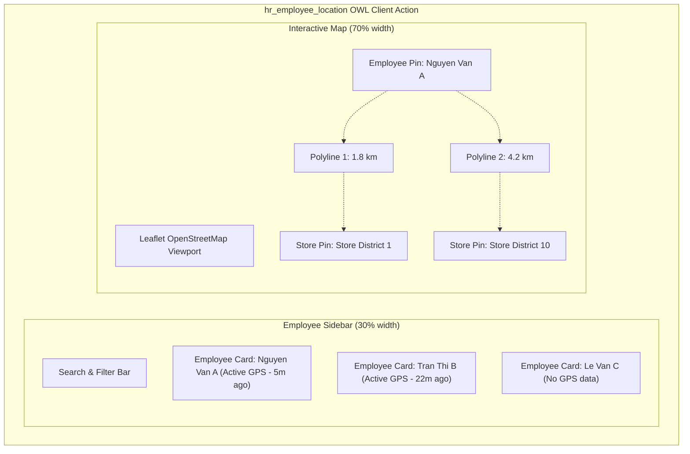
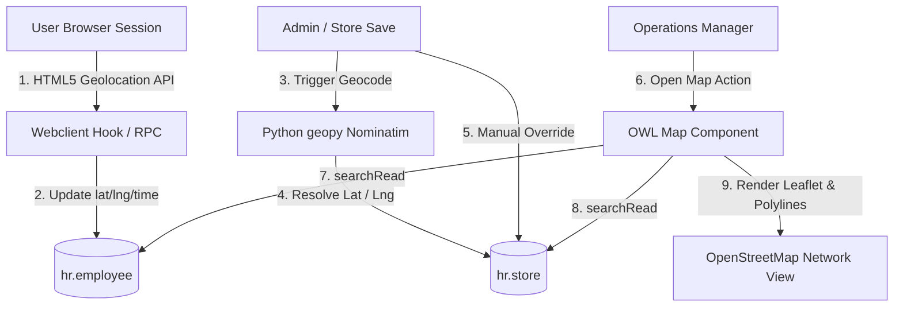
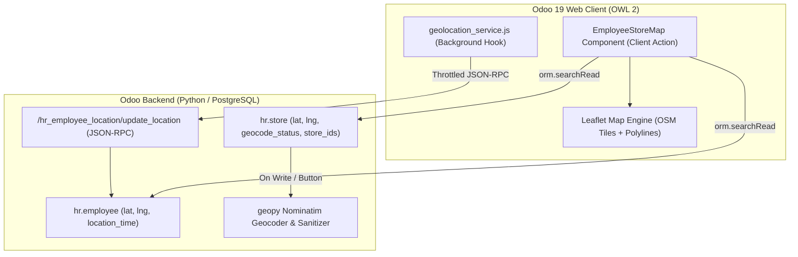

## Goal Capsule

- **Objective:** Give operations and HR managers real-time visual oversight of employee field presence relative to their assigned store locations by capturing coordinates on web client activity, precalculating store locations via `geopy`, and rendering an interactive OpenStreetMap network in an OWL workspace.
- **Means:** New custom module `hr_employee_location` extending `hr.employee` and `hr.store`, bundling Leaflet.js inside an OWL 2 client action. (KTD1, KTD2)
- **Product Authority:** Covers employee GPS extraction, store coordinate geocoding with admin overrides, and employee-to-store network map visualization. Surrounding audit or task modules (`store_checklist`, `daily_work_task`, `lug_phan_he`) are not active scope.
- **Open Blockers:** None.

---

## Product Contract

### Summary

The `hr_employee_location` module automatically captures employee GPS coordinates upon web client activity, geocodes store addresses into latitude and longitude via `geopy` with manual admin overrides, and provides an interactive OpenStreetMap / Leaflet OWL workspace showing employee pins and connected network rays to their assigned stores with real-time distance calculations.

### Problem Frame

Store managers and operations leaders currently lack real-time visibility into staff distribution across retail chains. Verifying whether a roaming supervisor, technician, or field salesperson is actually operating near their assigned store network requires tedious cross-referencing of chat check-ins, manual address lookups, and third-party map searches. Without an integrated map linking employee coordinates directly to store assets, auditing store coverage remains manual, error-prone, and slow.

### Key Decisions

- **Background GPS extraction on web client activity** (session-settled: user-directed — chosen over explicit check-in and periodic heartbeat polling: seamless coordinate capture without adding manual burden to daily work). Governs R1, R2, R3.
- **OpenStreetMap & Leaflet.js in OWL 2** (session-settled: user-directed — chosen over Google Maps and Mapbox: zero-cost open-source tile infrastructure with no external API keys or vendor lock-in). Governs R7, R8, R9.
- **Connected network rays with geodesic distance** (session-settled: user-directed — chosen over isolated markers or cluster-only views: draws directional polylines linking employee coordinates to assigned stores with precise kilometer metrics). Governs R10, R11, R12.
- **Dual-mode geocoding with geopy** (session-settled: user-directed — chosen over manual-only entry or background cron: automatically geocodes on store address save while providing an explicit form action and manual coordinate overrides). Governs R4, R5, R6.
- **Clean module architecture without backward compatibility or aliases** (session-settled: user-directed — chosen over legacy wrapper shims: built cleanly for Odoo 19 standards). Governs R13, R14.

### Actors

- A1. Store Staff / Employee: Accesses Odoo via browser; provides browser geolocation permission; coordinates update automatically during regular system use.
- A2. Operations / HR Manager: Opens the map workspace to inspect staff locations, search employees, and inspect store coverage networks.
- A3. Store Administrator: Maintains store profiles and addresses; reviews or manually fine-tunes store latitude and longitude coordinates.
- A4. Geocoding Engine (`geopy` / Nominatim): Resolves physical address strings into geographic coordinates with rate-limiting precautions.

### Requirements

#### Employee Location Capture

- R1. The web client must query HTML5 `navigator.geolocation.getCurrentPosition` upon user login and page navigation when the browser grants location access.
- R2. The system must store the latest coordinates on `hr.employee` in `last_latitude`, `last_longitude`, and `last_location_time` without disrupting user navigation.
- R3. If geolocation access is denied, times out, or is unsupported by the client device, the system must gracefully skip coordinate persistence without blocking user actions.

#### Store Geocoding & Coordinate Management

- R4. The `hr.store` model must include `latitude` (Float, digits=(10, 7)), `longitude` (Float, digits=(10, 7)), `geocode_status` (Selection: draft, success, failed, manual), and `last_geocode_time` (Datetime).
- R5. The system must invoke `geopy.geocoders.Nominatim` to calculate `latitude` and `longitude` when a store address is modified and saved, or when the admin triggers the "Locate on Map" button.
- R6. Administrators must be able to manually enter or edit `latitude` and `longitude` fields directly on the store form; manual entry must set `geocode_status` to `manual` and protect values from automated overwrite.

#### Map Workspace & Employee List (OWL 2)

- R7. The module must register an OWL 2 Client Action accessible from the main menu, loading an interactive OpenStreetMap container alongside an employee sidebar.
- R8. The sidebar must display a searchable, filterable list of active employees, indicating current location freshness ("Active GPS", "Stale GPS", or "No GPS").
- R9. The map viewport must render OpenStreetMap tiles via Leaflet.js with zoom controls, custom store markers, and employee location markers.

#### Network Graph & Distance Visualization

- R10. Clicking an employee in the sidebar must highlight that employee's marker on the map and draw visual network rays (polylines) connecting the employee to all assigned stores (`store_ids`).
- R11. Each network ray must compute and display geodesic distance in kilometers between the employee marker and the store marker, with a tooltip showing store name and travel distance.
- R12. When an employee is selected, the map must automatically pan and adjust zoom bounds (`fitBounds`) to encapsulate both the employee marker and all connected store markers.

#### Packaging & Compatibility

- R13. The module must be packaged cleanly as `hr_employee_location` with manifest dependencies on `base`, `web`, `hr`, and `hr_store`.
- R14. Code must conform to Odoo 19 native Python and OWL standards without introducing deprecated legacy aliases, obsolete JS widgets, or backward-compatibility shims.

### Visualizations

#### Split-Screen Workspace Layout



#### System Data Flow



### Key Flows

- F1. Automatic employee location capture upon web activity
  - **Trigger:** Employee logs into Odoo or navigates between views.
  - **Actors:** A1 (Employee), Webclient Geolocation Hook.
  - **Steps:** The webclient hook queries `navigator.geolocation.getCurrentPosition()`. Upon coordinate return, an asynchronous RPC call updates `last_latitude`, `last_longitude`, and `last_location_time` on the user's `hr.employee` record.
  - **Covers:** R1, R2, R3.

- F2. Store address geocoding with admin manual override
  - **Trigger:** Store address updated on `hr.store` form, or admin clicks "Locate on Map".
  - **Actors:** A3 (Admin), A4 (`geopy` Engine).
  - **Steps:** The backend cleans the address string and calls `geopy.geocoders.Nominatim`. If coordinates are found, `latitude` and `longitude` are updated with `geocode_status = 'success'`. If geocoding fails, `geocode_status = 'failed'` is set and admin enters coordinates manually.
  - **Covers:** R4, R5, R6.

- F3. Interactive employee selection and store network ray visualization
  - **Trigger:** Manager clicks an employee card in the sidebar list.
  - **Actors:** A2 (Manager), OWL Map Component.
  - **Steps:** The component highlights the selected employee in the sidebar, places an active employee pin on the map, fetches the employee's assigned `store_ids`, renders store markers, computes geodesic distance lines (polylines) from the employee to each store, and zooms the viewport to fit all points.
  - **Covers:** R7, R8, R10, R11, R12.

### Acceptance Examples

- AE1. Employee navigates Odoo with browser GPS permission granted
  - **Covers:** R1, R2.
  - **Given:** Employee Nguyen Van A is logged into Odoo on a browser with location permission granted.
  - **When:** Nguyen Van A navigates to any Odoo app or view.
  - **Then:** `last_latitude` and `last_longitude` on Nguyen Van A's `hr.employee` record update to current coordinates, and `last_location_time` updates to current timestamp.

- AE2. Employee denies browser GPS permission
  - **Covers:** R3, R8.
  - **Given:** Employee Le Van C has denied browser geolocation permissions.
  - **When:** Le Van C navigates in Odoo.
  - **Then:** No error alert or popup blocks Le Van C; on the manager's map sidebar, Le Van C is listed with a "No GPS" badge.

- AE3. Store address auto-geocoded successfully via geopy
  - **Covers:** R4, R5.
  - **Given:** Admin creates a store with address "11 Sư Vạn Hạnh, Phường 12, Quận 10, TP Hồ Chí Minh".
  - **When:** Admin saves the record or clicks "Locate on Map".
  - **Then:** `geopy` calculates latitude (~10.770) and longitude (~106.667), and `geocode_status` becomes `success`.

- AE4. Admin manually overrides coordinates
  - **Covers:** R6.
  - **Given:** Store address geocoding fails or places the pin slightly off-center.
  - **When:** Admin types manual values (10.7712, 106.6685) into Latitude and Longitude fields on the store form.
  - **Then:** The record saves with the manual coordinates, `geocode_status` updates to `manual`, and subsequent address saves do not overwrite the coordinates.

- AE5. Selecting employee renders network rays to assigned stores
  - **Covers:** R10, R11, R12.
  - **Given:** Employee Nguyen Van A has valid coordinates and is assigned to Store 1 (1.8 km away) and Store 2 (4.2 km away).
  - **When:** Manager clicks Nguyen Van A in the map sidebar.
  - **Then:** Two polylines render connecting Nguyen Van A's marker to Store 1 and Store 2, each showing travel distance in km, and the map bounds smoothly fit all three pins.

### Scope Boundaries

#### Deferred for later

- Historical GPS breadcrumbs and movement route replay (only latest active coordinates stored in v1).
- Reverse geocoding (translating raw employee coordinates back into physical street names).
- Automated geofence boundary alerts (triggering alarms if an employee moves beyond 500m of a store).

#### Outside this product's identity

- Fleet telematics, OBD vehicle diagnostics, or turn-by-turn driving navigation directions.
- External logistics dispatch or shipment routing algorithms.

#### Deferred to Follow-Up Work

- Integration with `store_checklist` Mystery Shopper validation to auto-verify that an auditor was physically inside the store during an audit submission.
- Mobile native GPS background worker integration outside standard browser tab sessions.

### Dependencies / Assumptions

- Odoo Version: Odoo 19.0.
- Core Dependencies: `base`, `web`, `hr`, and `hr_store`.
- External Python Library: `geopy` (>=2.4.0) installed in Odoo's Python environment.
- Asset Bundles: Leaflet.js (v1.9.4+) and Leaflet CSS packaged inside module `static/lib/leaflet/`.
- Client Requirement: HTTPS protocol enabled on deployment server (required by modern browsers for HTML5 Geolocation API).

### Outstanding Questions

- None blocking planning. Geocoder rate limiting is handled with standard Nominatim polite request headers.

### Sources / Research

- Python `geopy` test via `uv`: Tested `geopy` 2.5.0 with `geopy.geocoders.Nominatim` and `geopy.distance.geodesic`. Confirmed geodesic distance calculation and identified need for clean address strings and error handling (`GeocoderTimedOut`, `GeocoderUnavailable`).
- Odoo 19 OWL Architecture: Client action component structure using `@odoo/owl` (`Component`, `onMounted`, `onWillUnload`, `useRef`), registered in `@web/core/registry` under `actions`.
- Existing Ecosystem Grounding: Verified `hr.employee` in `lug_phan_he/models/hr_employee.py` and `store_checklist/models/store_role.py:87`; verified `hr.store` in `lug_phan_he/models/hr_store.py:6` and `store_checklist/models/hr_store.py:5`.

---

## Planning Contract

### Summary

The implementation builds a standalone Odoo 19 module (`hr_employee_location`) structured into five atomic units. The backend extends `hr.employee` with coordinate attributes and `hr.store` with geocoding automation via `geopy.geocoders.Nominatim`. A lightweight webclient service passively collects user coordinates throttled at 5-minute intervals. The user interface provides a responsive OWL 2 client action embedding vendored Leaflet.js to render OpenStreetMap tiles, employee markers, store markers, and interactive geodesic network lines with auto-panning bounds.

### Key Technical Decisions

- KTD1. **Vendored Leaflet.js in `static/lib/leaflet/`** (session-settled: user-directed — chosen over external CDN: guarantees offline local development and eliminates external asset delivery points). Governs R7, R9.
- KTD2. **Service-based Geolocation Hook with 5-Minute Throttle** (session-settled: user-directed — chosen over per-action RPC: caches location updates in browser sessionStorage and transmits at most once every 5 minutes to prevent database write churn). Governs R1, R2, R3.
- KTD3. **Two-Stage Address Normalization for Nominatim** (session-settled: user-directed — chosen over single-string geocoding: attempts full address first, falling back to comma-split street and district components when mall/floor names produce no match). Governs R5.
- KTD4. **Client-Side Polyline Calculation with Haversine/Leaflet Geometry** (session-settled: user-directed — chosen over server-calculated polyline RPCs: renders network rays and calculates distances instantaneously in the browser). Governs R10, R11, R12.
- KTD5. **Standard Odoo 19 Client Action Registration** (session-settled: user-directed — chosen over custom view tags: standard `action_employee_store_map` registered in `@web/core/registry` under `actions` category for maximum stability). Governs R7, R14.

### High-Level Technical Design

#### System Architecture & Layer Diagram



#### Module File Tree

```text
hr_employee_location/
├── __init__.py
├── __manifest__.py
├── controllers/
│   ├── __init__.py
│   └── geolocation_controller.py
├── models/
│   ├── __init__.py
│   ├── hr_employee.py
│   └── hr_store.py
├── security/
│   ├── hr_employee_location_security.xml
│   └── ir.model.access.csv
├── views/
│   ├── hr_employee_views.xml
│   ├── hr_store_views.xml
│   ├── menu_views.xml
│   └── action_views.xml
├── static/
│   ├── lib/
│   │   └── leaflet/
│   │       ├── leaflet.js
│   │       ├── leaflet.css
│   │       └── images/
│   └── src/
│       ├── geolocation/
│       │   ├── geolocation_service.js
│       │   └── geolocation_service.xml
│       └── map_workspace/
│           ├── employee_store_map.js
│           ├── employee_store_map.xml
│           └── employee_store_map.scss
└── tests/
    ├── __init__.py
    ├── test_geocoding.py
    └── test_geolocation_controller.py
```

### Assumptions

- The deployment environment provides internet connectivity to OpenStreetMap tile servers (`tile.openstreetmap.org`) or a local tile cache proxy.
- Modern browser user clients require HTTPS for HTML5 `navigator.geolocation` APIs; on non-secure HTTP contexts, the geolocation hook gracefully no-ops per R3.
- The `hr_store` module is present in the database, defining the base `hr.store` model.

### Sequencing & Dependencies

- U1 (Scaffolding & Security) establishes base module registration and access rules.
- U2 (Models & Geocoding) creates backend database columns and the `geopy` calculation logic. Depends on U1.
- U3 (Webclient Geolocation Hook) implements client-side location extraction and controller updates. Depends on U2.
- U4 (Leaflet Assets & Map Component) delivers the main OWL client action, side-panel employee list, and basic OSM map rendering. Depends on U1, U2.
- U5 (Network Ray Polylines & Distance Calculation) completes the interactive selection, polyline rays, and viewport auto-fitting. Depends on U4.

---

## Implementation Units

### U1. Module Scaffolding, Manifest & Security

**Goal:** Initialize the new `hr_employee_location` module structure, manifest, access control rights, and root menu definitions following Odoo 19 standards.

**Requirements:** R13, R14.

**Dependencies:** None.

**Files:**
- `hr_employee_location/__init__.py`
- `hr_employee_location/__manifest__.py`
- `hr_employee_location/security/hr_employee_location_security.xml`
- `hr_employee_location/security/ir.model.access.csv`
- `hr_employee_location/views/menu_views.xml`

**Approach:**
1. Create `__manifest__.py` with name "Bản đồ vị trí nhân viên & Cửa hàng", category "Human Resources", version "19.0.1.0.0", license "LGPL-3".
2. Set dependencies: `['base', 'web', 'hr', 'hr_store']`.
3. Register backend asset bundle `web.assets_backend` for upcoming Leaflet scripts, SCSS styles, and OWL components.
4. Define security groups in XML: User (read-only map access) and Manager (full map access, manual geocoding edit access).
5. Configure `ir.model.access.csv` ensuring standard user permissions on extended models.

**Patterns to follow:**
- Manifest structure in `store_checklist/__manifest__.py` and `lug_phan_he/__manifest__.py`.

**Test scenarios:**
- Module installs cleanly without dependency errors.
- Security groups load and assign correctly to admin and employee users.

**Verification:**
- Module installs with `odoo-bin -i hr_employee_location --stop-after-init` with return code 0.

---

### U2. Backend Models: Employee Location Fields & Store Geocoding Engine

**Goal:** Extend `hr.employee` with location attributes, extend `hr.store` with coordinate fields, and build the `geopy` geocoding engine with address fallback parsing and manual admin overrides.

**Requirements:** R2, R4, R5, R6. (Governed by KTD3)

**Dependencies:** U1.

**Files:**
- `hr_employee_location/models/__init__.py`
- `hr_employee_location/models/hr_employee.py`
- `hr_employee_location/models/hr_store.py`
- `hr_employee_location/views/hr_employee_views.xml`
- `hr_employee_location/views/hr_store_views.xml`
- `hr_employee_location/tests/__init__.py`
- `hr_employee_location/tests/test_geocoding.py`

**Approach:**
1. Extend `hr.employee` in `models/hr_employee.py`:
   - `last_latitude = fields.Float(string="Vĩ độ gần nhất", digits=(10, 7), readonly=True)`
   - `last_longitude = fields.Float(string="Kinh độ gần nhất", digits=(10, 7), readonly=True)`
   - `last_location_time = fields.Datetime(string="Thời gian ghi nhận GPS", readonly=True)`
   - `store_ids = fields.Many2many("hr.store", "hr_employee_location_store_rel", "employee_id", "store_id", string="Cửa hàng trực thuộc")`
2. Extend `hr.store` in `models/hr_store.py`:
   - `latitude = fields.Float(string="Vĩ độ", digits=(10, 7))`
   - `longitude = fields.Float(string="Kinh độ", digits=(10, 7))`
   - `geocode_status = fields.Selection([('draft', 'Chưa định vị'), ('success', 'Định vị thành công'), ('failed', 'Thất bại'), ('manual', 'Nhập thủ công')], default='draft')`
   - `last_geocode_time = fields.Datetime(string="Thời gian định vị")`
3. Implement `action_geocode_address()` on `hr.store`:
   - Initialize `geopy.geocoders.Nominatim(user_agent="odoo_store_geocoder", timeout=10)`.
   - Try geocoding full `address` string.
   - If no match, run fallback regex cleaning (stripping unit numbers, floor identifiers, e.g. "Tầng 1, Gian 23") and query street + district + city.
   - On match: write `latitude`, `longitude`, `geocode_status='success'`, `last_geocode_time=fields.Datetime.now()`.
   - On exception (`GeocoderTimedOut`, `GeocoderUnavailable`): set `geocode_status='failed'` and log warning.
4. Override `write()` and `create()` on `hr.store`:
   - If `latitude` or `longitude` changed directly by user, set `geocode_status = 'manual'`.
   - If `address` changed and `geocode_status != 'manual'`, trigger `action_geocode_address()`.
5. Add XML views adding coordinates and "Định vị tọa độ" button to `hr.store` form view, and GPS status notebook tab to `hr.employee` form.

**Patterns to follow:**
- Model extensions in `lug_phan_he/models/hr_store.py` and `store_checklist/models/store_role.py:87`.

**Test scenarios:**
- Happy path geocoding: Saving a valid address calculates coordinates and sets status to `success` (Covers AE3).
- Manual override: Admin updates `latitude` and `longitude` directly; status changes to `manual` and subsequent address edits do not overwrite coordinates (Covers AE4).
- Timeout/Error handling: Mocked `geopy` network timeout gracefully records `failed` status without crashing transaction.

**Verification:**
- Automated tests in `test_geocoding.py` pass cleanly.

---

### U3. Web Client Background Geolocation Hook

**Goal:** Build a non-intrusive OWL service that checks browser geolocation on user login/navigation, throttles updates to once per 5 minutes, and persists coordinates to `hr.employee`.

**Requirements:** R1, R2, R3. (Governed by KTD2)

**Dependencies:** U2.

**Files:**
- `hr_employee_location/controllers/__init__.py`
- `hr_employee_location/controllers/geolocation_controller.py`
- `hr_employee_location/static/src/geolocation/geolocation_service.js`
- `hr_employee_location/tests/test_geolocation_controller.py`

**Approach:**
1. Implement `GeolocationController` with route `/hr_employee_location/update_position`, `type='json'`, `auth='user'`:
   - Receives `latitude`, `longitude`, `timestamp`.
   - Finds current user's employee record (`request.env.user.employee_id`).
   - Updates `last_latitude`, `last_longitude`, `last_location_time` using `sudo()`.
2. Implement OWL service `geolocation_service` registered in `@web/core/registry` under `services`:
   - Checks `navigator.geolocation` availability.
   - Reads `sessionStorage.getItem('last_geo_sync')`. If synced within 300 seconds, skips to prevent RPC overload.
   - Calls `navigator.geolocation.getCurrentPosition(...)` with `maximumAge: 60000`, `timeout: 10000`, `enableHighAccuracy: true`.
   - On success: posts coordinates to controller, updates `sessionStorage`.
   - On permission denial or error: gracefully catches and silences errors without any UI disruption.

**Patterns to follow:**
- OWL services in Odoo 19 core webclient (`web/static/src/core/`).

**Test scenarios:**
- Controller updates employee coordinates successfully on valid input (Covers AE1).
- Controller rejects unauthenticated requests.
- Permission denial is caught silently in service without throwing uncaught promises (Covers AE2).

**Verification:**
- Controller tests pass; browser geolocation hook runs cleanly in webclient without console errors.

---

### U4. Leaflet Library Assets & OpenStreetMap OWL Map Workspace

**Goal:** Vendor Leaflet.js assets into the module and implement the split-screen OWL 2 Client Action with employee sidebar list and basic OpenStreetMap viewport.

**Requirements:** R7, R8, R9, R13. (Governed by KTD1, KTD5)

**Dependencies:** U1, U2.

**Files:**
- `hr_employee_location/static/lib/leaflet/leaflet.js`
- `hr_employee_location/static/lib/leaflet/leaflet.css`
- `hr_employee_location/static/lib/leaflet/images/*`
- `hr_employee_location/static/src/map_workspace/employee_store_map.js`
- `hr_employee_location/static/src/map_workspace/employee_store_map.xml`
- `hr_employee_location/static/src/map_workspace/employee_store_map.scss`
- `hr_employee_location/views/action_views.xml`

**Approach:**
1. Vendor Leaflet v1.9.4 production assets into `static/lib/leaflet/` and register in `web.assets_backend`.
2. Create OWL component `EmployeeStoreMap` extending `Component`:
   - Setup state: `employees: []`, `stores: []`, `selectedEmployeeId: null`, `searchQuery: ""`.
   - Lifecycle: `onMounted()` mounts Leaflet map on `useRef("mapContainer")` with OSM tile layer `https://{s}.tile.openstreetmap.org/{z}/{x}/{y}.png`.
   - Lifecycle: `onWillUnload()` destroys Leaflet instance (`this.map.remove()`) to prevent DOM memory leaks.
3. Fetch employee and store data via `this.orm.searchRead(...)`:
   - Employees: `id`, `name`, `job_title`, `last_latitude`, `last_longitude`, `last_location_time`, `store_ids`.
   - Stores: `id`, `name`, `code`, `address`, `latitude`, `longitude`.
4. Render split layout in XML: Left sidebar (300px-350px width) with search box and scrollable list of employee cards showing GPS freshness badges ("Đang hoạt động", "Mất tín hiệu", "Chưa có GPS"); right viewport hosting map container.
5. Register action `action_employee_store_map` in `views/action_views.xml` and wire to menu "Bản đồ nhân viên & Cửa hàng".

**Patterns to follow:**
- Client actions in `lug_project/static/src/shell/` and `daily_work_task/static/src/dashboard/`.

**Test scenarios:**
- Component mounts Leaflet map container without throwing null element references.
- Employees render in sidebar with accurate GPS freshness badges.
- Search filter accurately narrows employee list by name and job title.

**Verification:**
- Opening menu "Bản đồ nhân viên & Cửa hàng" loads the split-screen map interface with rendered OpenStreetMap tiles.

---

### U5. Network Ray Visualization, Real-Time Distance & Bounds Auto-Fit

**Goal:** Implement interactive employee selection on the map, rendering custom employee pins, store pins, geodesic network ray polylines, distance tooltips, and automatic viewport fitting.

**Requirements:** R10, R11, R12. (Governed by KTD4)

**Dependencies:** U4.

**Files:**
- `hr_employee_location/static/src/map_workspace/employee_store_map.js`
- `hr_employee_location/static/src/map_workspace/employee_store_map.xml`
- `hr_employee_location/static/src/map_workspace/employee_store_map.scss`
- `hr_employee_location/tests/test_employee_store_map.py`

**Approach:**
1. Implement custom Leaflet marker icons using standard SVG markers:
   - Blue marker with user icon for employee.
   - Red marker with store/building icon for stores.
2. In `selectEmployee(employeeId)`:
   - Clear existing temporary layer group (`this.networkLayerGroup.clearLayers()`).
   - If selected employee has valid `last_latitude` and `last_longitude`:
     - Add employee marker at `[last_latitude, last_longitude]`.
     - Find all stores belonging to `employee.store_ids`.
     - For each store with valid `latitude` and `longitude`:
       - Add store marker.
       - Calculate distance using Haversine formula in JavaScript:
         $d = 2R \cdot \arcsin\left(\sqrt{\sin^2(\Delta \varphi / 2) + \cos(\varphi_1)\cos(\varphi_2)\sin^2(\Delta \lambda / 2)}\right)$.
       - Draw `L.polyline([[empLat, empLng], [storeLat, storeLng]], { color: '#0d6efd', weight: 3, dashArray: '6, 6' })`.
       - Bind tooltip to polyline center: `"Khoảng cách: X.XX km"`.
     - Collect all active markers and trigger `this.map.fitBounds(group.getBounds().pad(0.2), { maxZoom: 16 })`.
   - If employee has no GPS coordinates:
     - Show notification toast: "Nhân viên chưa có dữ liệu vị trí GPS gần đây".
     - Render only their assigned stores on the map and fit bounds to stores.

**Patterns to follow:**
- Leaflet polyline and marker layers API.

**Test scenarios:**
- Selecting employee with 2 stores draws 2 distinct polylines with accurate kilometer tooltips (Covers AE5).
- Selecting employee with no GPS coordinates gracefully displays store markers without throwing NaN coordinates error.
- Viewport adjusts bounds smoothly with padding.

**Verification:**
- Interactive browser test confirms clicking employees draws connecting network rays to their stores and auto-zooms map viewport.

---

## Verification Contract

### Test Commands

Run the automated backend test suite using standard Odoo test runner:

```bash
python3 odoo-bin -c /path/to/odoo.conf -d test_db -u hr_employee_location --test-enable --test-tags /hr_employee_location --stop-after-init
```

Targeted unit test commands:
- Model & Geocoding tests:
  ```bash
  python3 odoo-bin -c /path/to/odoo.conf -d test_db --test-enable --test-tags hr_employee_location.test_geocoding --stop-after-init
  ```
- Controller & Hook tests:
  ```bash
  python3 odoo-bin -c /path/to/odoo.conf -d test_db --test-enable --test-tags hr_employee_location.test_geolocation_controller --stop-after-init
  ```

### Quality Gates

- Python code must pass PEP8 / Flake8 checks without unused imports or undefined variables.
- JavaScript OWL components must pass standard ES6 lint checks.
- All 5 units pass test scenarios with zero regressions on existing `hr.store` or `hr.employee` models.

---

## Definition of Done

- All 5 implementation units (U1 through U5) are completed and committed.
- Module installs cleanly on Odoo 19 with manifest dependencies satisfied.
- `geopy` calculates store coordinates on save and on demand, with manual admin overrides respected.
- Background geolocation hook captures coordinates on active web sessions without disrupting navigation.
- OWL 2 client action renders the OpenStreetMap interface with an employee sidebar.
- Clicking an employee highlights their pin, plots their assigned stores, draws connecting network rays with distance metrics, and auto-fits viewport bounds.
- All temporary debugging logs and test scratch files are removed.
